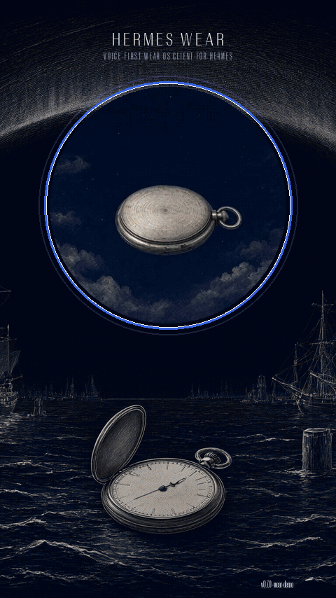
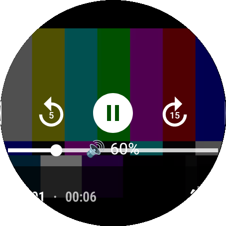
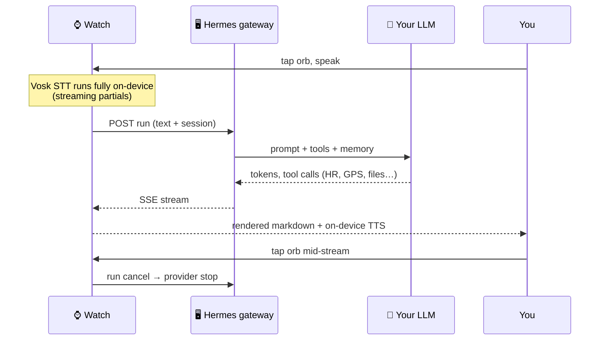
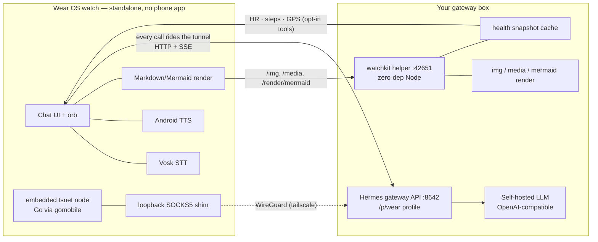
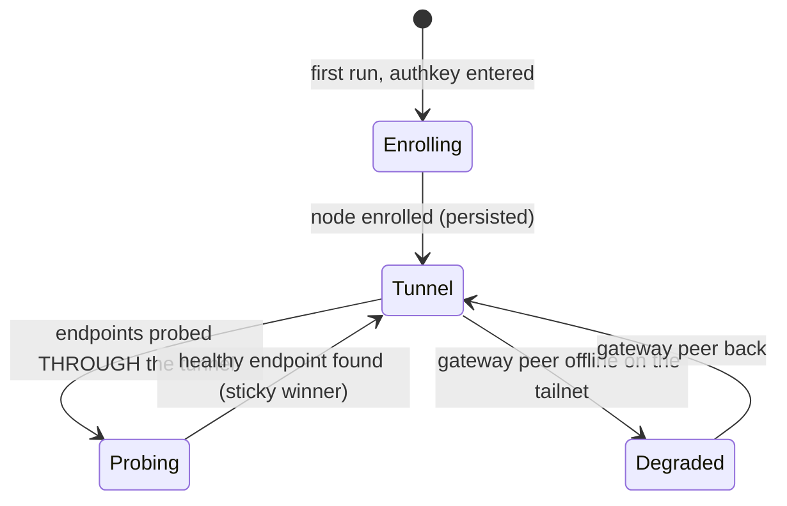

# Hermes Wear OS

**Your Wear OS watch talks directly to your own AI gateway.** No phone companion, no cloud relay, no
Telegram in the middle. Tap the orb, say a thing, and a real agent on your own box — with real tools,
memory, cron jobs, and your files — answers on your wrist, out loud, before your hand leaves the glass.


Everything heavy runs on your gateway. The watch streams text in, streams tokens back, renders the
answer (markdown, code, tables, **mermaid**, full-res images, **animated GIFs**, **generated
video and audio**), and speaks it with an on-device voice.
The app is Kotlin + an embedded Tailscale node (Go runtime via gomobile — it's why the APK is chunky)
+ a zero-dependency Node helper on the server side.

*Works with any [Hermes](https://github.com/borealBytes) gateway exposing its API server; the watch
brings its own Tailscale node, so it reaches your gateway from anywhere — no LAN, no router tricks.*

**Round-first — that's why every image here is a circle.** We mask screenshots to a circle because
that is exactly what the owner's Galaxy Watch shows. Under the mask the app renders a normal
480×480 Wear OS framebuffer; the round glass simply never shows those corners. On a square Wear OS
screen those corner pixels are real pixels you'll actually get — you see *more* than these
screenshots, never less — while the layout was designed for the circle from the first pass, so
nothing important ever lived in a corner anyway; round, square or rectangular, any Wear OS
screen face should take it, the corners being the only difference. This app is built and tuned
on Galaxy Watch
(Wear OS 5, min SDK 30): everything in it travels to other Wear OS watches except the optional
body-sensor tools, which ride Health Services — a capability Samsung watches provide and others
don't; elsewhere the app reports "health services: unavailable" on its own diagnostics screen and
carries on. Expect small per-OEM tweaks for non-Samsung watches (IME and notification-shade
mannerisms); a OnePlus Watch is next on the test bench.

<p align="center">
  <a href="https://youtu.be/Cd4Y_ESQoQ0"></a><br/>
  <sub>Click the strip for the <a href="https://youtu.be/Cd4Y_ESQoQ0">▶ full vertical tour</a> — 2:30,
  1080×1920, with a score by the owner's agent (the v0.6.0 cut; the v0.7.0 master ships with this
  release). Every feature at real wrist speed, captured live with no edits to the answers.</sub><br/>
  <sub>Splash art: <a href="docs/art-selfportrait.webp">her self-portrait</a> — engraved by the on-gateway
  image agent from its own idea of itself; it flashes for a beat on cold start, then gets out of your way.</sub>
</p>

<br clear="all"/>

## Why this exists

Your assistant shouldn't have to phone home to survive. This stack is *yours* end to end: the model,
the gateway, the watch client, the microphone path — all self-hosted, default-configured to leak
nothing. Voice stays on the watch unless you explicitly send audio to your own server. Replies stream
over your tailnet (through the watch's own node), never through a third-party relay, and the cache on the watch is
encrypted and bounded. It's the "own your stack" demo that lives on your wrist.

## What you get

| | |
|---|---|
|  |  |
| **Streaming markdown**, rendered for a round screen: headings, bold, italics, bullets, numbered lists, and tap-to-expand code chips — with math in real unicode (`E = mc²`, subscripts), because LaTeX doesn't render on 1.4 inches. **Links are links:** tap one and the watch's browser takes it. Pinch to scale text (double-tap resets); media keeps its own zoom. | **Real tables from plain markdown** — bold header, hairline rule, aligned cells, no pipe vomit; wider tables degrade to readable rows instead of a grid you can't parse. |
|  |  |
| **Sessions, from your wrist** — every session your agent has, newest first, with a scrolling chip row to filter in one tap (`all` / per-agent / `💻 computer` — desktop-and-web lanes — / `archived`); one-tap new, and a **voice-or-type search** over every chat (server-side full-text). Opening a session re-pulls its gateway tail by itself — a chat that kept talking elsewhere shows the rest without a manual refresh. | **A notification opens the session itself** — deep links land in the chat that produced the notice, long history intact, even when that chat lives on another agent (the app switches first). |
|  |  |
| **Images at full resolution** — a gateway image skill's aurora render, shown inline full-res; cards and skill charts mix into the answer flow. Tap any card to open the viewer. | **Zoom viewer** — double-tap jumps to 2.5× (pinch works too), drag to pan, close with the ✕ chip or the back button. |
|  |  |
| **Generated video and audio play in chat** — when the desktop can render a clip, so can the wrist: `MEDIA:` lines and media-extension links land as cards (tap to play · fullscreen), inline in the answer flow exactly like images. | **Full-screen player, bezel-steered** — media3 transport with skip chips, and on a rotating-bezel watch the **bezel spins the PLAYER volume** while it's on screen (5 % detents, one haptic tick each, fading 🔊 readout — the 60 % here came off that exact code path over adb). Close the sheet, and the bezel is system volume again. |
|  |  |
| **Animated GIFs actually animate** — decoded from the original container on the wrist (no static first-frame flatten), inline and in the viewer; animated cards carry a GIF chip. This frame is a screen recording, circle-masked: the bars are moving. | **Pinch-to-zoom video** — the same zoom lane the image viewer has, living inside the player itself: pinch to 3×, drag to pan, double-tap toggles fit↔2.5×, and taps still raise the transport. |
|  |  |
| **Audio gets the same front door** — an Opus clip from the gateway's media pipeline opens a full-screen sheet with the media3 transport; the bezel steers its volume exactly like video's. | **See what the tools did** — every run that touches a tool carries a collapsible activity card: step count, per-tool commands, done ✓. The desktop's verbosity box, on your wrist, persisted in the transcript. |
|  | **One conversation, either device.** A chat started at the desktop opens on the wrist with its whole history (gateway-first backfill — the orange "from" pill counts the rows that arrived from the gateway), you keep talking in the *same* session, and it keeps answering for the desktop too. No fork, no second copy: the cross-lane door is a one-column promote the watch does for you (SPEC §12.13), always reversible, and the desktop's own view never drifts. Manual fork stays exactly where it was — in your hand, on the session sheet. |
|  |  |
| **Tap-to-talk** — tap the orb and just talk; a pause sends it (on-device VAD). Tap again mid-speech to *cancel* the half-sentence, tap after a pause to send now. | **Kill mid-run** — the orb turns red while a run streams; press it and the *server-side* run cancels, not just the UI. |
|  |  |
| **Mermaid diagrams render** — flowchart answers come back as pictures, via a gateway render helper (and cached): the prompt chip above, the rendered card below, real skill data inside the nodes. | **Slash commands and skills** — flick the ⌘ lane for a searchable overlay: the gateway's command catalog, your agent's **skills** (this wear-demo agent lists `/compact`, `/academic-paper`, `/academic-pipeline`…), and watch-local actions; an unrecognized `/text` just goes to the agent as a prompt. |
|  |  |
| **Search every session, every agent** — one query hits the gateway's full-text index; results come back across all your agents with the matching line quoted and the hit bracketed. | **Long-press any session row** — ⑂ fork it into your agent and keep talking, 🗃 archive it off-canvas (undo one more long-press away), or 🗑 delete behind a real double-tap confirm. |
|  |  |
| **Edit & resend** — tap any sent prompt: the sheet quotes it back with **Edit & resend** (and Copy); the edited copy goes out as a fresh run while the original thread stays intact. | **Or type it anywhere** — the system keyboard sits one flick away and rides every text surface: composer, editor, session search — with the keyboard's own mic for dictation. |
|  |  |
| **Pinch to scale text — the full range, honestly captured.** At the minimum (×0.75) whole paragraphs sit per line. | Same chat at the maximum (×1.6) — one glanceable line at a time. Transcript type scales; images, charts, and cards keep their own size; double-tap resets to 1.0. |
|  |  |
| **Per-chat model picker** — the 🧠 lane lists what your gateway exposes (default, provider back-ends, counts) and the header says the scope: *this chat only*. Every other chat keeps its own model. | **Picked = routed** — the toast confirms the exact id (`claude-fable-5.1`), the next reply rides that model, and the gateway's usage log carries one call under it. The watch never bakes model names in; it lists what the gateway lists. |
|  |  |
| **Links are links** — a markdown link in an answer is blue, underlined, tappable; the watch hands the URL to its browser and you read it on your wrist. | **Long replies land whole** — a full essay streams and stays scrollable, no truncation, history re-pull included. |
|  |  |
| **Approvals, in-session** — a gated tool call (here `rm` + `ls`) pauses the run and shows the *full command* on a card: OK / No, no app-switching, no terminal. | **Tap OK — the run resumes** — the tool executes mid-run and the settled answer arrives in the same thread, seconds later. |

Plus: a GBoard prompt editor for long asks (with a big `Send`), pinch text scaling,
TTS that speaks every reply by default (the orb's 1:30 drag mutes it), gateway notifications with approve
buttons, and a diagnostics screen in Settings.

## How the orb works

The orb is the **only control** on the chat screen — every button that used to crowd the dial
became a drag direction instead. (The dial mid-flight — ring open, lanes lit, release-select — is
in the film above.)

- **Tap** — listen. The orb warms up and transcribes as you speak (on-device Vosk); a pause sends
  it, a second tap mid-speech cancels the half-sentence.
- **Tap while an answer streams** — stop the run. The orb burns red while the gateway is working;
  one press cancels the *server-side* run, not just the UI. It also burns red **while it speaks** —
  there a tap just mutes (the answer already landed), and a press-and-hold in either state pops the
  dial ring in place so you can grab the keyboard or a `/steer` mid-answer without stopping anything.
- **Press, hold, drag** — the dial. Hold the disc for a beat and a ring appears around it: nine
  wedges, each with an icon and a label. Keep your finger down and slide around the ring — the lane
  under your finger highlights — and **whatever lane you're on when you let go is the one that
  fires.** The ring is up in under 100 ms and the icons sit outside the activation gate, so once
  you've learned the map it's a blind flick.

The nine directions, on the default map (clock-face — every one remappable, and `off` blanks a
direction so an accidental drag does nothing; keyboard is pinned at 12:00 — fastest reach for the
most-used lane):

| Clock | Lane | Release does… |
|---|---|---|
| 12:00 | ⌨ **keyboard** | opens the text editor — type it, or use the keyboard's own mic |
| 1:20 | 🔊 **mute** | toggles spoken replies (TTS is on by default); dwell 2 s here and the ring becomes a volume slider for THIS agent |
| 2:40 | ⚙ **settings** | straight to Settings — because getting there otherwise is a finger-crawl (`record` → hi-fi whisper STT lives on as a remap lane, roadmap in progress) |
| 4:00 | 🧠 **model** | per-chat model picker — lists only what your gateway has enabled; the pick is remembered for that chat, and "gateway default" hands it back |
| 5:20 | ⌘ **commands** | the searchable slash-command overlay (gateway catalog + your recents) |
| 6:40 | 💬 **chats** | your chat list for the current agent |
| 8:00 | ≡ **sessions** | the session browser — adopt desktop sessions, fork, archive, delete |
| 9:20 | 👤 **agents** | the agent picker — persona, tools, session space, and gateway key swap together |
| 10:40 | ✅ **approvals** | the approval-mode sheet for THIS chat — inherit, manual, smart, off |

Remap any direction at **Settings ▸ Display ▸ Orb dial** — tap a direction's row and it advances to
the next action. The chat reads the change live: the very next flick obeys the new map, and the ring
icons redraw with it.


## The back button never quits

Physical **back** is a loop, not an exit (owner batch 6: *"chat to sessions to agents, then back to
chat again — the app shouldn't really quit unless I hit the home button"*):

- **Deep in something** — a sheet, the keyboard editor, the agent picker, the ⌘ overlay, an image
  viewer — back closes exactly that one layer, topmost first, until you're back on a main screen.
- **On a main screen** — back walks the ring: **Chat → Sessions → Agents → Chat**, forever. The app
  never finishes from back.
- **To leave** — press **home**. And the owner's daily-driver setup: assign **double-press home**
  (Wear settings) to open Hermes — wrist up, two taps, and you're back in your last session mid-
  thought, ready to ask. New session when you want one is two taps and a tap.

## Notifications, while you're out

Out of the app, the watch speaks fluent Wear OS: settled runs and approval requests arrive as
**standard notifications** — the preview shows on your wrist like any message, and tapping it (the
open-app action) **deep-links straight into the session that produced it**, not just the app.
Approval notifications carry **Approve / Deny** buttons that answer the run without opening
anything. And because they're ordinary notifications on ordinary channels, your **Do Not Disturb,
mute, and per-app settings all apply** — the watch never shouts over a meeting you told it to
respect.

| | |
|---|---|
|  |  |
| **Settled while you're away** — the answer lands as an ordinary Wear notification, orb-spirit avatar and all; the reply text is right in the card. | **Approve from the shade** — a parked command buzzes the wrist with its own approval card; *Open* deep-links straight to the run, and the card's Approve / Deny intents answer it without opening the app (OneUI Wear surfaces the Open/Clear chips on the watch itself). |

## The voice suite, the splash, and the desktop watch

| | |
|---|---|
|  |  |
| **A cold start opens on a moving film frame** — the intro film plays and the app *reveals itself mid-motion inside the film* (`revealIsMoving`, one clean cut), so the splash is a doorway, not a wallpaper. Held from the launcher it rides the same film. **Tap anywhere while it plays and you're in** — the tap cuts the film and lands you in the app the moment it's ready, so the 14 s intro never stands between you and an ask. And the film is strictly for fun: the owner's first fully AI-generated video, made locally end to end (Qwen Image stills, MiniMax motion, stitched on the same box) — and it has audio. Fun. | **Splash modes are yours** — Settings ▸ Display: the built-in film, a static frame, your own picked media, or none at all. Markdown, launch splash, and the orb live on this one page. |
|  |  |
| **Voice out, fully on-device** — the engine picker, system voice with fallback, reply speed (this wrist reads at 1.81×), and a preview button, all on one Settings page. | **Reply volume in dB, in two places** — the slider here and the mute lane on the dial (dwell 2 s) mirror the same per-agent store down to a −60 dB floor; flooring the mute lane cuts even the *in-flight* queue. |
|  |  |
| **The glass follows the voice** — while a reply is spoken the sentence being read stays in view, teleprompter-style; one touch hands scroll control back to you mid-speech. | **Pick your audio path per agent** — Local Vosk (offline default), the vendor recognizer honestly labeled OFF-DEVICE (Google or Samsung, whichever your watch ships), or Gateway: whisper rows (final when you stop) and parakeet (streaming partials) — the highlighted row is the live source. |
|  |  |
| **A desktop run parks on your wrist** — when a session running at your desk hits a gated command, the parked command buzzes your watch; *Open* adopts the session and answers it from the wrist. | **Answers finished off the wrist** — an ordinary notification says "answer ready", and one tap drops you into the thread mid-stream. The off-screen feed survives Samsung's cached-process freeze (WorkManager chain, shared cursor, no double-post on handback). |

| | |
|---|---|
|  |  |
| **Scroll by rolling the rim of the glass** — an edge-drag circles any list (settings, agents, models, approvals, chats), thumb never leaving the bezel — and normal swipes still scroll. | **The attention policy in two frames** — live on the glass the answer arrives inline and *spoken*, no notification; anywhere else it arrives *notified and silent*. It never shouts twice. |

The gateways manager is a real registry — several gateways saved, one winner dot chosen by the
health probe, failover in seconds — and underneath it the **agent-key matrix**: a ✓/— per profile,
learned from watchkit's read of the profiles' `.env`s (re-learned on a self-timed sweep, so a newly
created agent is asking-ready before you ever tap it). Agents without a key still list their
sessions; asking them needs the key:

 

## Anatomy of a round trip



## Architecture



Three moving parts:

| Piece | What it is |
|---|---|
| `app/` | The watch app. Kotlin, Wear Compose, OkHttp/SSE. No Google services, no Firebase, no push. |
| Hermes gateway | Any Hermes install: point it at a profile (e.g. `wear`) with a persona, tools, and an API key. SSE run streaming + cancel. |
| `server/watchkit/` | Optional zero-dependency Node daemon: mermaid → PNG, full-res `/img` serving from allow-listed roots (GIFs verbatim — the animation survives), `/media` pre-shrink (H.264+AAC / Ogg-Opus) so clips stream smooth on wrist Wi-Fi, opt-in body-tool snapshot cache (+ MCP for the agent), cron/job probes. A render sidecar — never in the run path (SPEC §12.13). |

## Voice, honestly

There is no free, offline, *perfect* STT on a watch today. The Voice-in page offers three honest
paths (and one keyboard back door):

| Path (the picker's own words) | Where audio goes | Quality | Default |
|---|---|---|---|
| **Local Vosk · offline** | never leaves the watch | Best-effort on-device. Nails short commands and dictation you speak *at* it; garbles names and mumbles. Clear speech, or edit-and-resend. | ✅ default |
| **OFF-DEVICE · vendor (Google or Samsung)** | the vendor's cloud — whatever recognizer your watch ships | Usually the best raw accuracy on the watch, at the cost of the vendor hearing it. The picker says **OFF-DEVICE** even when the vendor caches locally — that's deliberate. | your choice |
| **Gateway · whisper** (`watchkit /stt/whisper`) | your own box, through your own tunnel (the mic clip rides as **Opus**, AAC fallback — watchkit sniffs the container) | Noticeably better than Vosk — but buffered: the final text lands when you stop talking. Model choice is a row on the Voice page. | opt-in |
| **Gateway · parakeet** (streaming) | your own box, through your own tunnel (same Opus wire) | `scripts/parakeet.sh` sets the model up for you (Parakeet Unified EN 0.6b, GGUF, no GPU). Its edge over a built-in Hermes whisper is **streaming**: partials flow back while you talk, at the latency of you↔your gateway, so the transcript is nearly finished when your sentence is. | opt-in |
| GBoard typing → its mic | Google's cloud | Best raw accuracy available on the watch — at the cost of Google hearing it. | your choice |

TTS is the opposite story: Android's on-device TTS is default **on**, so replies come back *spoken*
without touching a cloud voice. Mute is one dial flick (drag the orb toward 1:20) — since batch 3 the orb is the *only* control on the chat screen: nine drag directions stand in for every button, and the ⌘ lane at 5:20 opens the slash overlay. Reply loudness is PER AGENT — the Voice page slider, the mute-lane dwell slider on the dial, and the satellite all ride the same per-agent store. While it reads aloud, the chat keeps the SPOKEN sentence in view (karaoke follow); and a fresh reply rests just above the orb from sentence one, growing upward, instead of starting at the top of the circle.

## Networking: the watch's own tailnet node is the transport

The app embeds a real Tailscale node (`tsnet`, no system Tailscale needed anywhere). Enrollment
takes one reusable authkey from your tailnet admin console (Settings ▸ Gateways ▸ Tailnet, or
setup), and from then on **every** call — REST, answer streams, image fetches, the STT WebSocket —
leaves the watch through a private WireGuard tunnel to your gateway, over any Wi-Fi. No LAN
requirement, no phone in the path, no third-party relay: your tailnet is the network.

The watch still keeps an ordered list of gateway endpoints (probe, pick, sticky winner — so a
second tailnet FQDN or a LAN literal reached *through* the tunnel can serve as fallback) — and
everything is visible and editable on the watch: Settings ▸ Gateways is a real multi-gateway
manager, not a single URL box. Tailnet truth lives one level down in Settings ▸ Gateways ▸
Tailnet: node name, key, live phase, and a Test button that health-checks the gateway through
the exact tunnel an ask rides:




| Piece | You get | Setup |
|---|---|---|
| **Watch node** (`hermes-wearos-<you>.your-tailnet.ts.net`) | answers from anywhere with Wi-Fi | mint a *reusable, non-ephemeral* authkey (admin ▸ Keys), hand it over once |
| **Gateway** (`http://<gateway-fqdn>.ts.net:8642`) | the API the watch rides the tunnel to | run `tailscale` on the gateway box; nothing else — tailscaled accepts tunnel traffic itself |
| **LAN literal** (`http://192.168.1.50:8642`) | optional extra endpoint | reached THROUGH the tunnel too; useful only with the dev escape hatch (`tailnet_on off`) |

The old model — watch outside the tailnet, reaching `.ts.net` names only when the *router* did
the resolving, LAN at home as fallback — is retired; SPEC §11.4 keeps the full decision record.

Inside the gateway manager, every saved gateway is a row — here the owner's box (its hostname
pixelated, per this repo's own privacy rule) and a parked LAN-literal fallback, each with its
live probe dot, the current auto-selected winner marked, the transport line above
(`wifi(wlan0) · validated`), and the active endpoint's editor beginning below:


## What it weighs — and why it never grows

Compiled today (debug build — the R8 hardening pass is on the roadmap): the APK is **≈106 MB**,
and the watch's own numbers say what that is made of:

| What | Size | Honest footnote |
|---|---|---|
| dex (your code, unshrunk) | ~46 MB | debug builds skip R8 entirely — this is the fat part, and the roadmap's release pass shrinks it hardest |
| embedded tailnet node (`libgojni.so` — tsnet via gomobile, 2 ABIs) | ~44 MB | the price of "no LAN, no phone, no relay": a real WireGuard node in the app; the watch's `armeabi-v7a` slice alone is 21 MB |
| Vosk JNI (`libvosk.so`, 2 ABIs) | ~18 MB | the STT engine binary; x86_64 rides the emulator build for free |
| splash intro film | 0.9 MB | yes, the fun part is under a megabyte |
| resources + everything else | ~2 MB | media3, Compose, the lot |

Optional pieces live OUTSIDE the APK: the Vosk acoustic model is **68 MB** pushed once into the
app's files dir (`scripts/get-vosk-model.sh`; the Settings ▸ About page tells you whether it's
there, and deleting it just falls back to vendor/gateway STT).

**The part watches usually die of — cache creep — doesn't exist here.** The app writes no disk
cache at all (the entire `cache/` dir after a full day of streaming, images, and voice: **25 KB**):
mermaid and image cards render from streamed bytes held in memory, custom splash media is read
*in place* through its persistable URI (never copied), and the body-snapshot cache is server-side
on your watchkit with a freshness cap — expiring on the gateway, not on your wrist. Chat history
lives where chat history belongs: in the gateway's session store, of which the watch keeps nothing
but the session id it's riding. Six months from install, the app's footprint is the same
kilobytes it shipped with. The only thing that can grow your watch's storage is the next app you
install.

## Body tools (opt-in, owner-off by default)

The watch can feed its own sensors to the agent — behind independent toggles, all default **off**.
Stated with zero marketing:

| Tool | Today, on the Galaxy Watch this was built against | Data path |
|---|---|---|
| `watch_heart_rate` | ✅ works — streams what Health Services actually delivers | Health Services → signed snapshot → gateway → agent |
| `watch_steps` | ✅ works — same, with daily counter semantics | same |
| `watch_location` | one-shot GPS fix (fresh on chat-ask, last-known on timers) | watch GPS → snapshot |
| `watch_spo2` · `watch_sleep` | ⚠️ **toggle is live; data is not** — Samsung's Health Services exposes neither to Wear apps, so the toggle flips and nothing arrives | wiring complete, source silent |
| auto-attach digest | piggybacks the digest on each ask, battery-aware | snapshot → ask body |


Snapshots are pushed over TLS to *your* watchkit, cached server-side with a freshness cap, and exposed
to the agent as both MCP-style tools and raw JSON. Nothing is forwarded anywhere else. The `DataType`
constants are matched tolerantly (real-world crashes taught us that), so the moment a device *does*
expose SpO2 or sleep it surfaces with no watch update. On non-Samsung vendors the toggles simply
report "vendor not available" and everything else keeps working.

The ⚠️ rows are a target, not a resignation: the plan for blood oxygen, sleep, and every other signal
Samsung keeps behind its own apps is to **reverse-engineer the vendor channels** until they talk.
The goal is honestly greedy — pull in every measurement this watch is physically capable of, whether
Health Services offers it politely or not. Until then the toggles tell the truth: wired, waiting,
quiet.

Everything about the app — gateways, tokens, toggles, font scale, session — lives on the watch.
Every knob is on-device, and there are no hidden ones:

| | |
|---|---|
|  |  |
| **Agent switcher** — every profile your gateway serves, one per row, on one tap: persona, tools, session space, and base URL swap together. Each profile's gateway key is **learned automatically** (watchkit reads the profiles' `.env`s — the key matrix under Gateways shows ✓ per agent), and one shared `API_SERVER_KEY` across profiles = one login for the whole gateway. | **Display settings** — markdown toggle, launch-splash modes, pinch-text scale with its live multiplier, and the orb dial's directions right in the list: tap any row to remap that direction. |
|  |  |
| **Nothing to install on the phone** — the whole assistant is one icon on the watch's app grid. | **Support without a support line** — Settings ends in an About page that states its own truth: shipped version, STT model presence, license, and who made it; when something is off, you read it there, on the wrist, offline. |

## Install — let your agent do it

This repo is built to be installed by *your AI coding agent* (the file `AGENTS.md` is its contract —
read it to your agent, or let it read the repo). Paste this into OpenCode / Claude Code / Codex at
your gateway machine:

```text
Install this for me: git clone https://github.com/borealBytes/hermes-wearos && cd hermes-wearos
Read AGENTS.md and follow it end to end: bootstrap the toolchain, build the APK, configure
watchos.config.json from my Hermes profiles, install to the watch (wireless debug — expect the
port to rotate, use the chunked-push recipe), then verify health + one ask end to end. Interview
me only for what you cannot detect.
```

The script equivalent, if you prefer doing it by hand:

```bash
scripts/bootstrap.sh                    # JDK + Android SDK + gradle, folder-local, no root
cp watchos.config.example.json watchos.config.json   # your endpoints + token (gitignored)
scripts/setup.sh                        # build → install → push config → health-check
```

`setup.sh` knows the ugly parts: wireless-debug port rotation on real watches, chunked
`split -n l/14` installs with md5 verification (single-pipe pushes on flaky wifi links die mid-flight),
`svc power stayon` + `deviceidle disable` hardening, and token auto-detect from
`~/.hermes/profiles/wear/.env` when the gateway is this same machine. `--dry-run` shows the plan first.

<details>
<summary>What <code>AGENTS.md</code> covers (the contract your agent gets)</summary>

- prereq detection (JDK, SDK, adb, optional emulator via `scripts/emulator.sh`)
- interview *only* unknowables (endpoints, which profile); auto-detect tailscale FQDN, `API_SERVER_KEY`
- the real-watch install recipe (port rotation warning, hardening one-liners, chunked push + md5)
- config push over `DevAskReceiver` debug extras (token, gateways, watchkit, brief job id)
- verify checklist: `/health` 200, one streamed ask round-trip, one screenshot
- troubleshooting table (offline device ⇒ rotated port; EOF pushes ⇒ chunked; degraded sessions row, etc.)

</details>

## Gateway-side setup (5 minutes, once)

```yaml
# ~/.hermes/profiles/wear/config.yaml  — minimal
toolsets: [hermes-cli]
mcp_servers:
  hermes-watchkit:
    command: node
    args: ["/path/to/hermes-wearos/server/watchkit/watchkit.mjs"]
# ~/.hermes/profiles/wear/.env
API_SERVER_KEY=<64-hex>          # what the watch authenticates with
```

Persona: copy `docs/wear-SOUL.example.md` to `~/.hermes/profiles/wear/SOUL.md` and make it yours —
it teaches the agent to answer short, mark down-lite, unicode math, never LaTeX, and to render
mermaid as fence blocks (the watch renders them). Start the watchkit helper with
`scripts/watchkit.sh` or the bundled `server/watchkit/hermes-watchkit.service`.

## Privacy

- **Audio stays on-device** in the default config (Vosk). Whisper fallback sends audio to *your* gateway only. GBoard's mic is Google — documented, opt-in.
- **TTS is on-device** by default (no cloud voice calls).
- Text + run streaming go **only** to your configured gateways, through the watch's own tailnet
  node (SPEC §11.4) — no relay, no companion app, no LAN requirement.
- On-watch cache is **encrypted at rest and size-bounded**; delete = app data wipe.
- Body data flows **only** when you flip the toggles; snapshots push to your watchkit, nowhere else.
- No analytics. No crash reporter. No push tokens. `grep` for tracking SDKs: nothing.

## Develop

```bash
source scripts/env.sh
../devkit/gradle/current/bin/gradle :app:assembleDebug :app:testDebugUnitTest   # 441 tests
scripts/emulator.sh                        # optional headless Wear emulator
scripts/doctor.sh                          # toolchain + link health report
```

- `docs/SPEC.md` — the full architecture spec **and Appendix A: an unexpurgated build log** (every
  trap hit: Wear Compose 1.4.1 quirks, 32-bit-only watch ABI, Samsung `DataType` name drift, SLC
  anchor fights, flaky wireless debug installs). If you build for watches, read it before fighting the
  same ghosts.
- `docs/DEMO.md` — the living demo-production ledger: every feature mapped to its screenshot **and**
  its beat in `demo-vertical.mp4`, the README change checklist, capture recipes and the verification
  gates. `scripts/demo-check.sh` enforces the ledger mechanically. Keep it current when features land.
- `app/src/debug/.../DevAskReceiver.kt` — adb-broadcast harness (`-e text '...'`, `-e ptt_demo`,
  `-e fontscale`, `-e agent …`): scriptable end-to-end demos, which is exactly how every screenshot
  in this README was captured.
- Target: Wear OS 5+ (API 33+); round hardware is the design target, square faces render with
  the corner bonus (see the round-first note up top). Physical-verified on a Galaxy Watch Ultra
  (Wear OS 6, 480×480, 32-bit userspace → `armeabi-v7a`).

## Limitations & roadmap

- [ ] **Whisper auto-fallback** wired into the voice loop (endpoint exists today; app-side confidence gate is next).
- [ ] **Blood oxygen + sleep data**: toggles are wired and waiting; Samsung exposes neither to Wear — the path is reverse-engineering the vendor channels (and every other signal the watch can emit that we're not yet pulling).
- [x] **tsnet node in-app** — shipped: the watch joins your tailnet itself (embedded `tsnet` via
      a gomobile shim), and the tunnel is THE transport — no LAN path, no tailscale-enabled router
      required (SPEC §11.4).
- [ ] Play-store signing + R8 hardening pass; today it's a debug-build project.
- [ ] Complications + tile. On-wrist launch currently = app icon (or voice link).
- [ ] Six-digit pairing flow polish (S5) for first-run UX on a stranger's watch.
- [ ] Wear-side mermaid fallback when the gateway render helper is offline.

## Built with

- **OpenCode** driving development end to end — **against a self-hosted `Qwen3.8-Flash-Next-Uncensored`
  served locally by SGLang**. Yes: this app was mostly written by a local model talking to a local
  agent harness, on the same machine it serves the watch from. The build log in
  `docs/SPEC.md` Appendix A is that collaboration's fossil record. Along the way we studied a few
  reference components of the Wear OS stack — the Wear Compose sample app, Vosk's Android examples,
  Google's watch-assistant demos — purely as learning material: **no code was reused**, everything
  here was written for this app.
- Wear Compose 1.4.1, OkHttp + SSE, `androidx.health`, Vosk, nothing else you'd spot in a
  dependency audit.

## License

MIT — see [LICENSE](LICENSE). Screenshots were captured on a physical Galaxy Watch Ultra (and, for
the v0.7.0 batch, the headless Wear OS 5 emulator at the same framebuffer size — the bezel-volume
frame on that build is driven through the exact key path the physical bezel fires); the demo
chats use neutral scripted prompts, and every visible pixel is exactly what the watch showed.
