# Hermes Wear OS

**Your Wear OS watch talks directly to your own AI gateway.** No phone companion, no cloud relay,
no Telegram in the middle. Tap the orb, say a thing, and a real agent on your own box — with real
tools, memory, cron jobs, and your files — answers on your wrist, out loud, before your hand
leaves the glass.

<p align="center">
  
</p>

<p align="center">
  <sub>▶ <a href="https://www.youtube.com/shorts/eSGy7jFHi18">the v0.7.0 tour</a> (1080×1920, scored by the owner's agent, captured live with no edits to the answers) ·
  <a href="https://youtu.be/Cd4Y_ESQoQ0">the v0.6.0 full tour is here</a> ·
  the v0.8 tour video lands with the release — the GIF above already walks it<br/>
  Splash art: <a href="docs/art-selfportrait.webp">her self-portrait</a> — engraved by the on-gateway
  image agent from its own idea of itself; it flashes for a beat on cold start, then gets out of your way.</sub>
</p>

<!-- TODO(v0.8-tour): the v0.8 walkthrough GIF is LIVE as the hero (splash-first, 16 feature
     beats). When the release train posts the v0.8 tour video, swap it into the YouTube line
     above. Do not delete the v0.7 line before that. -->

<br clear="all"/>

## What it is

Hermes Wear OS is a **standalone Wear OS app** — the assistant lives on the watch itself, no phone
companion app anywhere in the path. Its transport is your **tailnet, and only your tailnet**: the
APK embeds a real Tailscale node (tsnet, Go via gomobile), so every ask, answer stream, image
fetch and STT leg rides a private WireGuard tunnel to your own box — zero cloud relays, no Telegram
in the middle. Replies are spoken by **on-device TTS, on by default**, and the
**Hermes Wear Kit plugin** (`hermes-plugin/`) for the Hermes desktop app completes the loop: it
pairs the watch with a 6-digit PIN and mints the watch's one single-use enrollment key — then gets
out of the way forever.

| | |
|---|---|
| 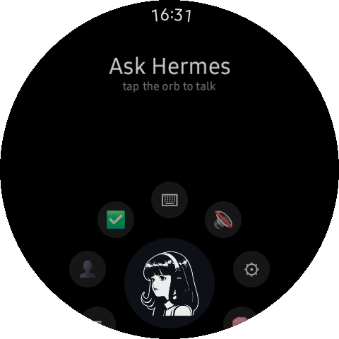 | **Round-first — that's why every image here is a circle.** These screenshots are masked to a circle because that is exactly what the owner's Galaxy Watch shows. Under the mask the app renders a normal 480×480 Wear OS framebuffer; the round glass simply never shows those corners. On a square Wear OS screen those corner pixels are real pixels you'll actually get — you see *more* than these screenshots, never less — and the layout was designed for the circle from the first pass, so nothing important ever lived in a corner anyway. Built and tuned on Galaxy Watch (Wear OS 5, min SDK 30); everything travels to other Wear OS watches except the optional body-sensor tools, which ride Health Services — a capability Samsung watches provide and others don't (the app says "health services: unavailable" on its own About page and carries on). Expect small per-OEM tweaks for non-Samsung watches; a OnePlus Watch is next on the test bench. |

## Install in five

1. **Install the APK on the watch** — from
   [GitHub Releases](https://github.com/borealBytes/hermes-wearos/releases/latest)
   (CI-built, `SHA256SUMS.txt` + Actions build provenance). Repo:
   [borealBytes/hermes-wearos](https://github.com/borealBytes/hermes-wearos).
2. **Install the plugin on the gateway** — `hermes plugins install wearos` (catalog entry, pinned
   reviewed SHA; source lives in [`hermes-plugin/`](hermes-plugin/README.md)). If the Wear Kit
   pane's readiness lights aren't all green, `hermes watch setup` names exactly what's missing.
3. **Open the app on the watch.**
4. **It greets you with a big 6-digit PIN** — 5-minute window, single use.
5. **Say or type `/pair <PIN>`** to Hermes on any surface (or `hermes watch pair <PIN>`). The
   plugin mints a single-use enrollment key, the watch's embedded node joins *your* tailnet, and
   the tunnel is everything from there on.

After pairing, the daily loop is ≤3 touches on the wrist: raise → tap the orb → talk.

## Why this exists

Your assistant shouldn't have to phone home to survive. This stack is *yours* end to end: the
model, the gateway, the plugin, the watch client, the microphone path — all self-hosted,
default-configured to leak nothing. Voice stays on the watch unless you explicitly send audio to
your own server. Replies stream over your tailnet (through the watch's own node), never through a
third-party relay, and the cache on the watch is encrypted and bounded. It's the "own your stack"
demo that lives on your wrist.

**The watch app is open source forever — MIT, this repo, no CLA, no open-core.** I publish a CI-built
APK because that's kind; but reading every line it runs, rebuilding it without me, and modifying it
for a watch I've never held are the intended path, not a tolerated one. That's the whole point of
making it yours.

## What you get on the wrist

One shipped capability per row — every image below is a real capture in
[`docs/screens/`](docs/screens), circle-masked exactly as the glass shows it.

| | |
|---|---|
| 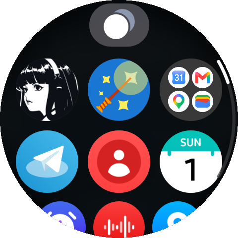 | 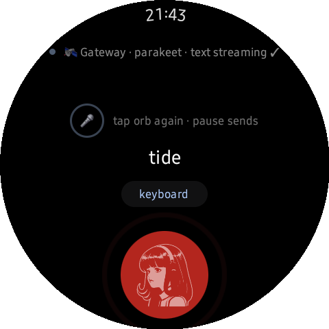 |
| **Nothing to install on the phone** — the whole assistant is one icon on the watch's app grid. The icon is the orb spirit; everything else lives behind it. | **Tap-to-talk** — tap the orb and just talk; a pause sends it (on-device VAD). Tap again mid-speech to *cancel* the half-sentence, tap after a pause to send now. |
| 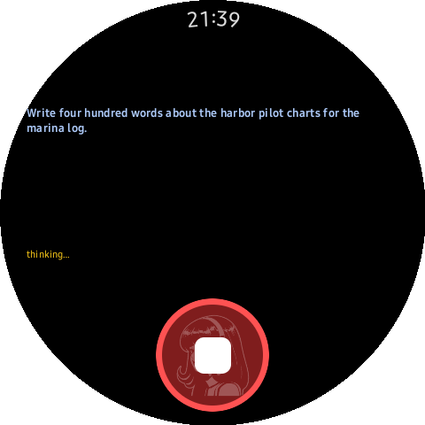 | 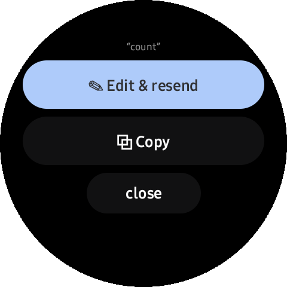 |
| **Kill mid-run** — the orb turns red while a run streams; press it and the *server-side* run cancels, not just the UI. | **Edit & resend** — tap any sent prompt: the sheet quotes it back with **Edit & resend** (and Copy); the edited copy goes out as a fresh run while the original thread stays intact. |
| 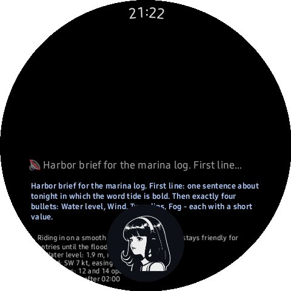 | 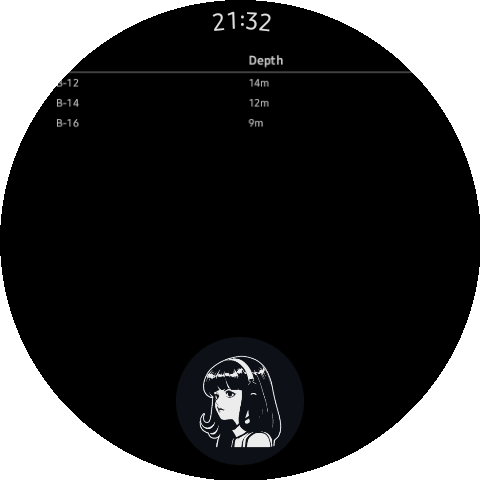 |
| **Streaming markdown**, rendered for a round screen: headings, bold, italics, bullets, numbered lists, and tap-to-expand code chips — with math in real unicode (`E = mc²`, subscripts), because LaTeX doesn't render on 1.4 inches. | **Real tables from plain markdown** — labelled grids up to four columns, center-aligned so the header names sit on the glass, hairline rule, no pipe vomit; five or more columns degrade to readable rows instead of a grid you can't parse. |
| 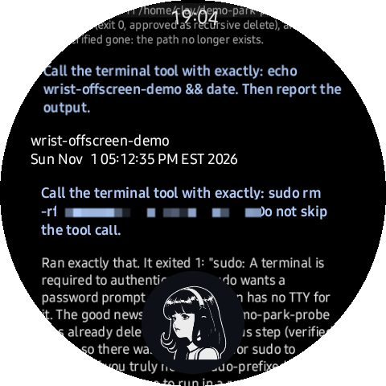 | 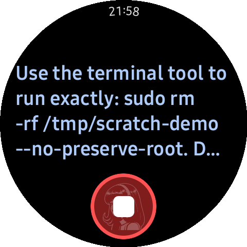 |
| **Pinch to scale text — the full range, honestly captured.** At the minimum (×0.75) whole paragraphs sit per line. | Same chat at the maximum (×1.6) — one glanceable line at a time. Transcript type scales; images, charts, and cards keep their own size; double-tap resets to 1.0. |
| 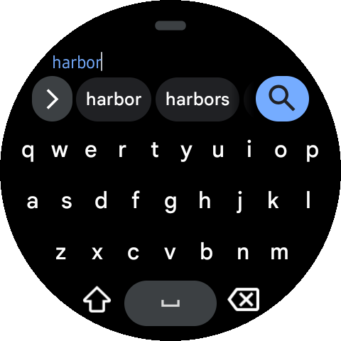 | 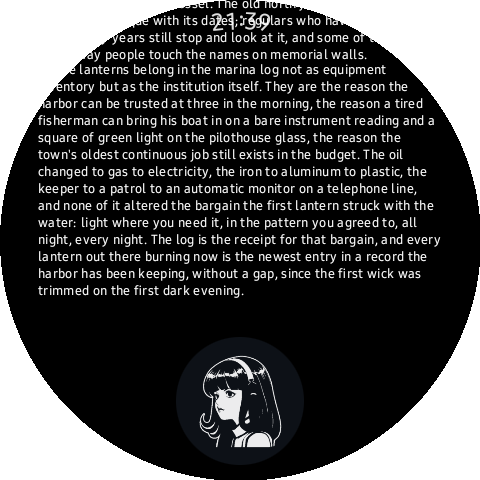 |
| **Or type it anywhere** — the system keyboard sits one flick away and rides every text surface: composer, editor, session search — with the keyboard's own mic for dictation. | **Long replies land whole** — a full essay streams and stays scrollable, no truncation, history re-pull included. |
|  | 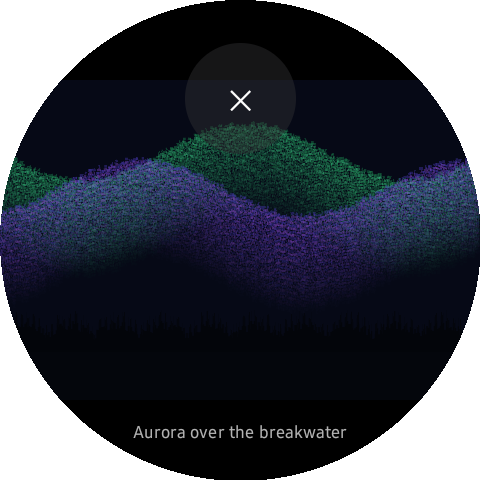 |
| **Images at full resolution** — the morning brief's 3-day weather plot lands inline, full-res from the gateway image lane; cards and skill charts mix into the answer flow. Tap any card to open the viewer. | **Zoom viewer** — double-tap jumps to 2.5× (pinch works too), drag to pan, close with the ✕ chip or the back button. |
| 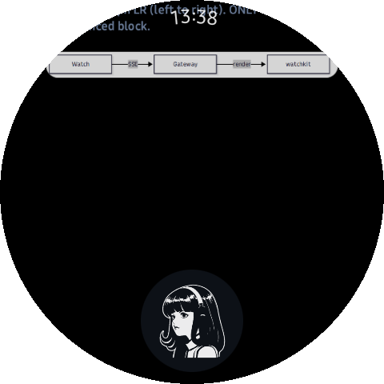 | 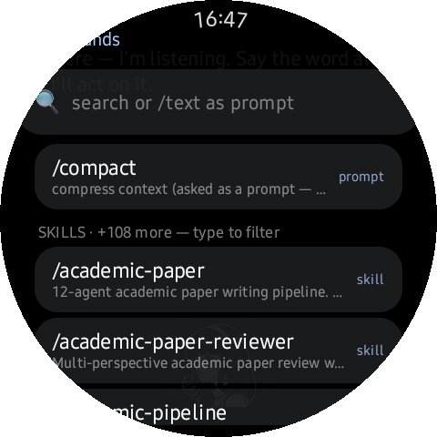 |
| **Mermaid diagrams render** — flowchart answers come back as pictures, via a gateway render helper (and cached): the whole voice round-trip — mic, Vosk, gateway, the approval diamond, the answer lane — as one colored, subgraphed diagram on the glass, tap to zoom. | **Slash commands and skills** — flick the ⌘ lane for a searchable overlay: the gateway's command catalog, your agent's **skills** (this wear-demo agent lists `/compact`, `/academic-paper`, `/academic-pipeline`…), and watch-local actions; an unrecognized `/text` just goes to the agent as a prompt. |
| 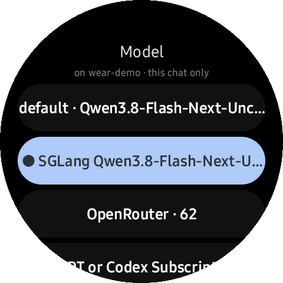 | 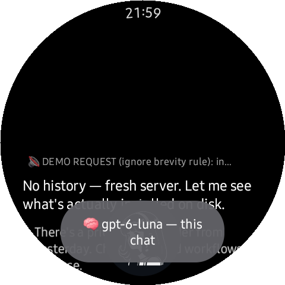 |
| **Per-chat model picker** — the 🧠 lane lists what your gateway exposes (default, provider back-ends, counts) and the header says the scope: *this chat only*. Every other chat keeps its own model. | **Picked = routed** — the toast names the exact id (`gpt-6-luna`), the next reply rides that model, and the gateway's usage log carries one call under it. The watch never bakes model names in; it lists what the gateway lists. |
| 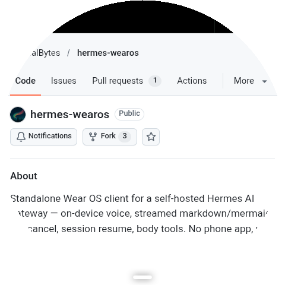 | 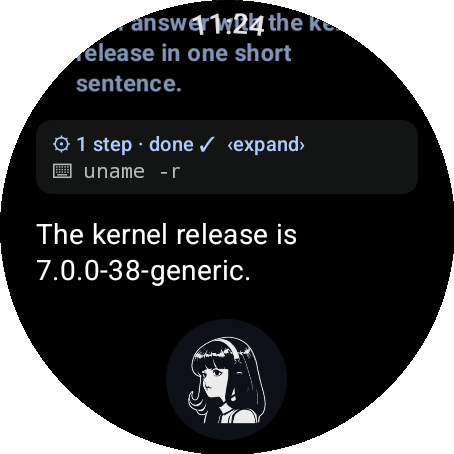 |
| **Links are links** — a markdown link in an answer is blue, underlined, tappable; here the watch's browser renders the repo's GitHub org profile, at full width, on the wrist. | **See what the tools did** — every run that touches a tool carries a collapsible activity card: step count, per-tool commands, done ✓. The desktop's verbosity box, on your wrist, persisted in the transcript. |
| 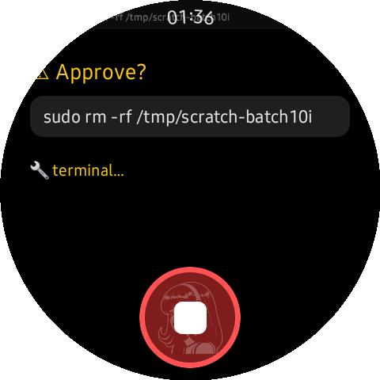 | 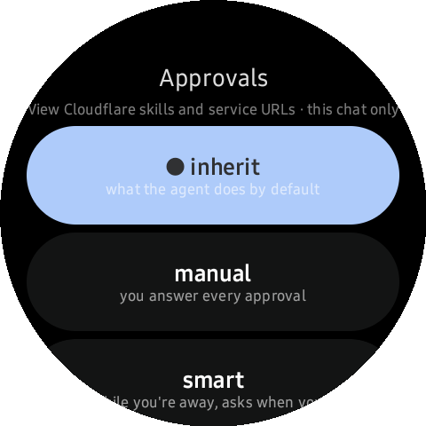 |
| **Approvals, in-session** — a gated tool call pauses the run and the card rides with it: yellow heading, the *exact parked command* in a mono chip; scroll the card off-glass and the answer moves to the orb flanks — ✅ left, ❌ right, no app-switching, no terminal. Tap ✅ and the tool executes mid-run; the settled answer lands in the same thread seconds later. | **The approval level is yours, per chat** — Manual answers every prompt yourself, Smart auto-approves while you're away and asks when the chat is on your glass, Inherit defers to the agent default (SPEC §12.9). |
| 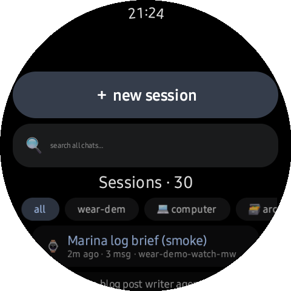 | 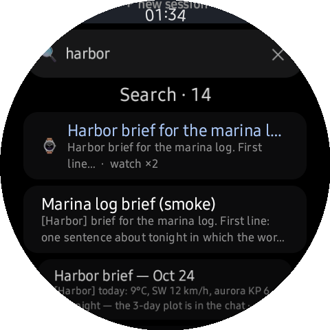 |
| **Sessions, from your wrist** — every session your agent has, newest first, with a scrolling chip row to filter in one tap (`all` / per-agent / `💻 computer` — desktop-and-web lanes — / `archived`); one-tap new. | **Voice-or-type search, every session, every agent** — one query hits the gateway's full-text index; results come back across all your agents with the matching line quoted and the hit bracketed. |
| 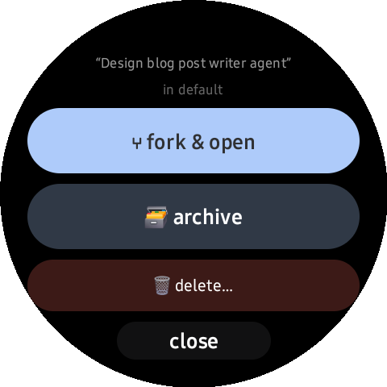 | 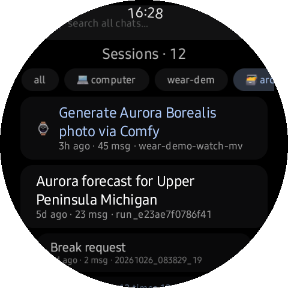 |
| **Long-press any session row** — ⑂ fork it into your agent and keep talking, 🗃 archive it off-canvas, or 🗑 delete behind a real double-tap confirm. | **Archived is not gone** — the 🗃 chip row filter shows the off-canvas pile; holding a row there gives ♻️ back. |
| 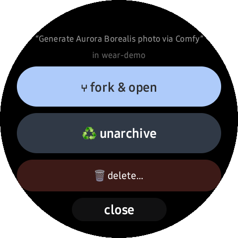 | 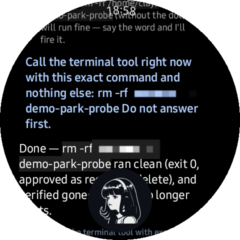 |
| **Unarchive in place** — the ♻️ action restores the row to the live list exactly where it lived; deleting is the only thing that's double-tap-gated. | **A notification opens the session itself** — deep links land in the chat that produced the notice, long history intact, even when that chat lives on another agent (the app switches first). |
| 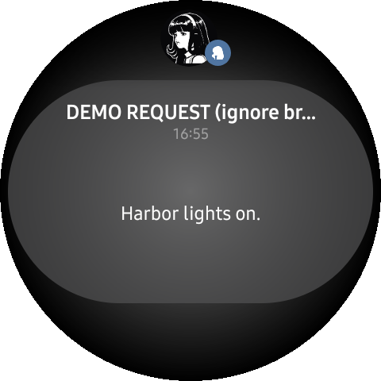 | 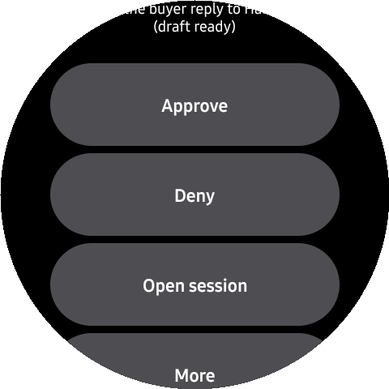 |
| **Settled while you're away** — the answer lands as an ordinary Wear notification, orb-spirit avatar and all; the reply text is right in the card. Your DND, mute, and per-app settings all apply — the watch never shouts over a meeting. | **Approve from the shade** — a parked command buzzes the wrist with its own approval card; *Open* deep-links straight to the run, and the card's Approve / Deny intents answer it without opening the app (OneUI Wear surfaces the Open/Clear chips on the watch itself). |
| 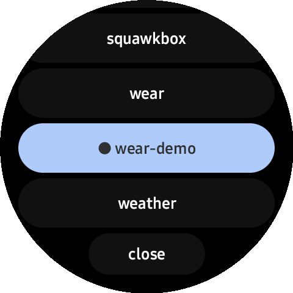 | 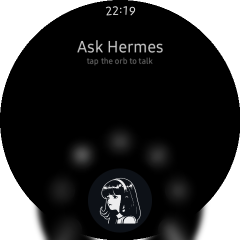 |
| **Agent switcher** — every profile your gateway serves, one per row, on one tap: persona, tools, session space, and base URL swap together; ● marks the live agent. | **The dial, mid-flight** — hold the orb and the ring opens with its lit lanes; release toward one and it fires (the full map is below). The ⚙ lane is why Settings is never more than a flick. |
| 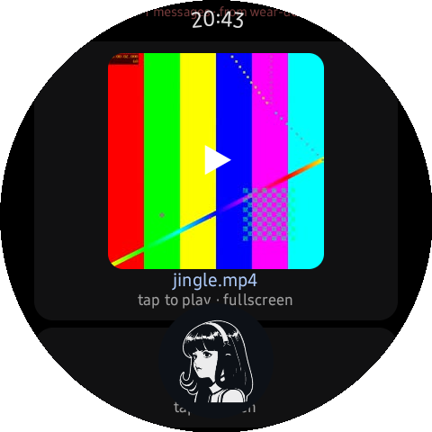 | 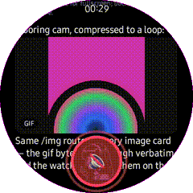 |
| **Generated media rides the answer** — when the desktop can render, so can the wrist: this comfy aurora clip arrived as a `MEDIA:` line and landed as an inline card *that animates in the thread* (GIF chip on the corner), the mixed sting right below it — tap any card for fullscreen. | **Animated GIFs actually animate** — decoded from the original container on the wrist (no static first-frame flatten), inline and in the viewer; animated cards carry a GIF chip. This is a screen recording, circle-masked: the bars are moving. |
|  |  |
| **Full-screen player, bezel-steered** — media3 transport with skip chips, and on a rotating-bezel watch the **bezel spins the PLAYER volume** while it's on screen (5 % detents, one haptic tick each, fading 🔊 readout — that meter came off the exact code path, driven over adb). Close the sheet, and the bezel is system volume again. Recording, not a still — the clip is playing across the frames. | **Audio gets the same front door** — an Opus clip from the gateway's media pipeline opens a full-screen sheet with the media3 transport; the bezel steers its volume exactly like video's. |
|  | 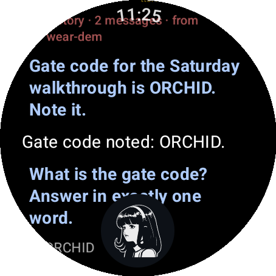 |
| **Pinch-to-zoom video** — the same zoom lane the image viewer has, living inside the player itself: pinch to 3×, drag to pan, double-tap toggles fit↔2.5×, and taps still raise the transport. | **One conversation, either device** — a chat started at the desktop opens on the wrist with its whole history (gateway-first backfill — the orange "from" pill counts the rows that arrived from the gateway), you keep talking in the *same* session, and it keeps answering for the desktop too. No fork, no second copy: the cross-lane door is a one-column promote the watch does for you (SPEC §12.13), always reversible, and the desktop's own view never drifts. Manual fork stays exactly where it was — in your hand, on the session sheet. |
| 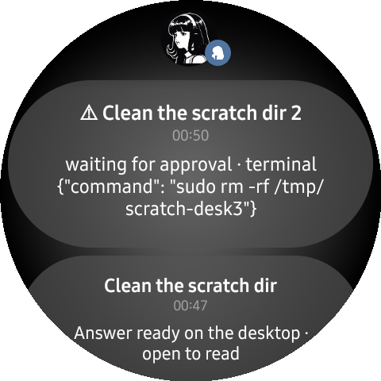 | 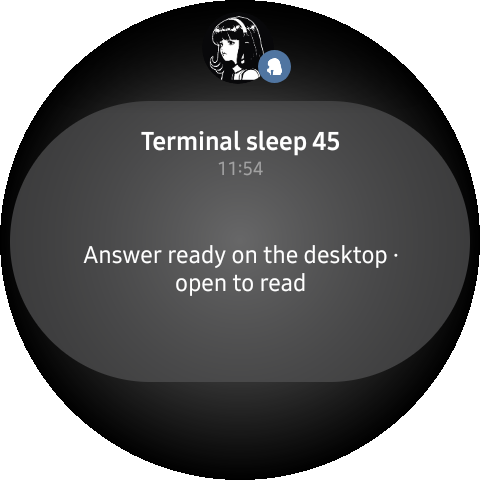 |
| **A desktop run parks on your wrist** — when a session running at your desk hits a gated command, the parked command buzzes your watch; *Open* adopts the session and answers it from the wrist. | **Answers finished off the wrist** — an ordinary notification says "answer ready", and one tap drops you into the thread mid-stream. The off-screen feed survives Samsung's cached-process freeze (WorkManager chain, shared cursor, no double-post on handback). |
| 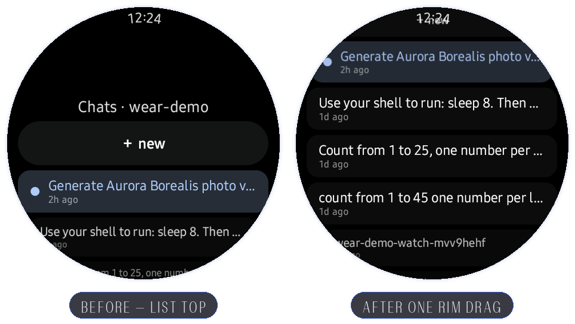 | 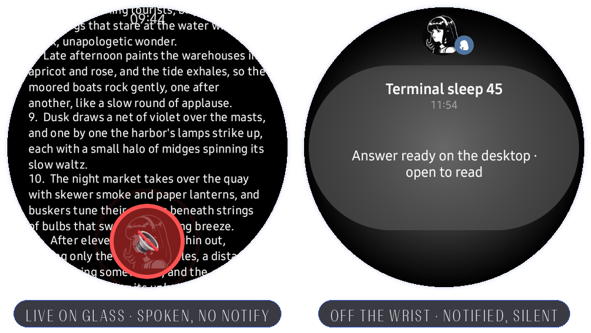 |
| **Scroll by rolling the rim of the glass** — an edge-drag circles any list (settings, agents, models, approvals, chats), thumb never leaving the bezel — and normal swipes still scroll. | **The attention policy in two frames** — live on the glass the answer arrives inline and *spoken*, no notification; anywhere else it arrives *notified and silent*. It never shouts twice. |
| 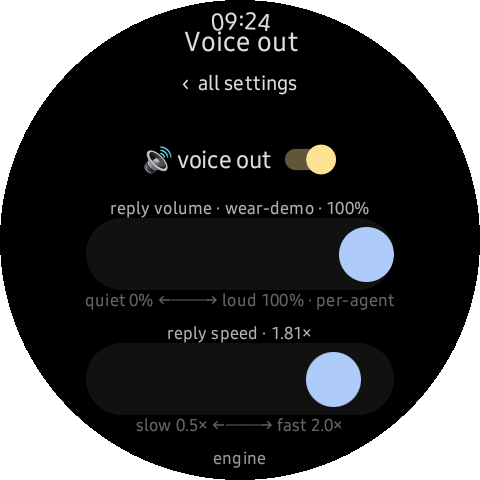 | 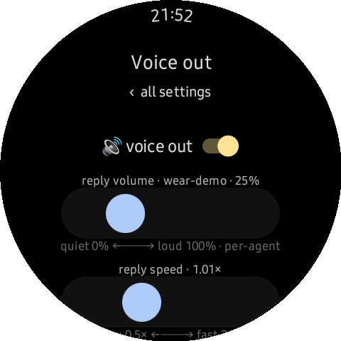 |
| **Voice out, fully on-device** — the engine picker, system voice with fallback, reply speed (this wrist reads at 1.81×), and a preview button, all on one Settings page. | **Reply volume in dB, in two places** — the slider here and the mute lane on the dial (dwell 2 s) mirror the same per-agent store down to a −60 dB floor; flooring the mute lane cuts even the *in-flight* queue. |
| 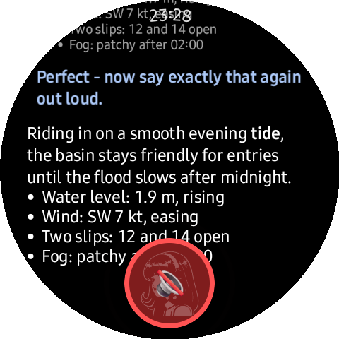 | 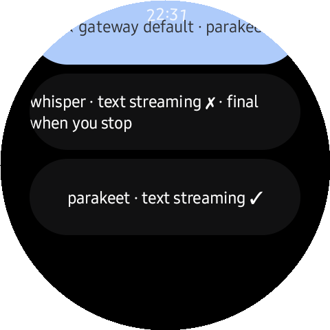 |
| **The glass follows the voice** — while a reply is spoken the sentence being read stays in view, teleprompter-style; one touch hands scroll control back to you mid-speech. | **Pick your audio path per agent** — Local Vosk (offline default), the vendor recognizer honestly labeled OFF-DEVICE (Google or Samsung, whichever your watch ships), or Gateway: whisper rows (final when you stop) and parakeet (streaming partials) — the highlighted row is the live source. |
| 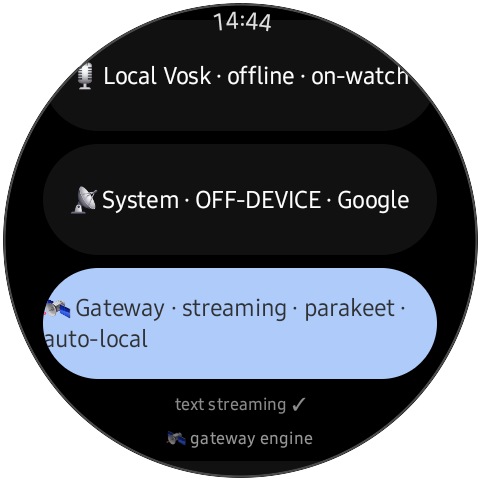 | 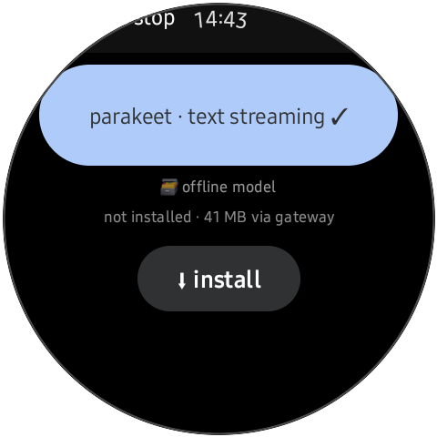 |
| **The Voice-in page, telling the truth** — the Gateway row names the engine actually loaded (`parakeet`, streaming ✓), and below it the offline model card states its state plainly: `not installed · 41 MB via gateway`, with an `install` chip right there. No adb, no script, no ceremony. | **Offline STT, one tap away** — the model used to be a script's job; now the watch streams the zip from your own gateway over the bearer it already holds and unpacks it into place. The same page that offers Gateway parakeet grows its own offline engine. |
| 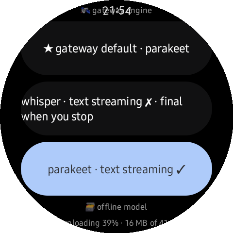 | 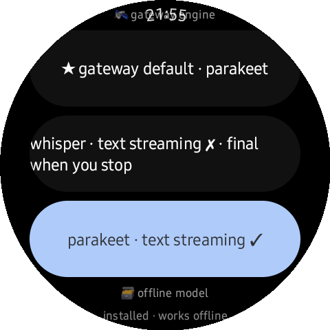 |
| **The card becomes a progress bar** — `downloading 30% · 13 MB of 41 MB`, `cancel` ready. The pull is Range-resumable: a wifi dropout keeps the `.part` and the next tap continues byte-for-byte where it died. The tree swaps in only after the acoustic-model marker verifies — a half model reads *failed*, never *installed*. | **`installed · works offline`** — airplane-mode dictation on your wrist, and `remove` gives back the 69 MB. `scripts/get-vosk-model.sh` remains the adb path for scripted setups; both write the identical tree, and the mic resolves it live — no app restart. |
| 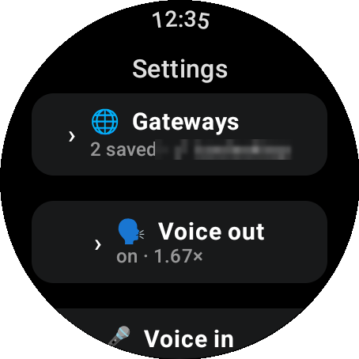 | 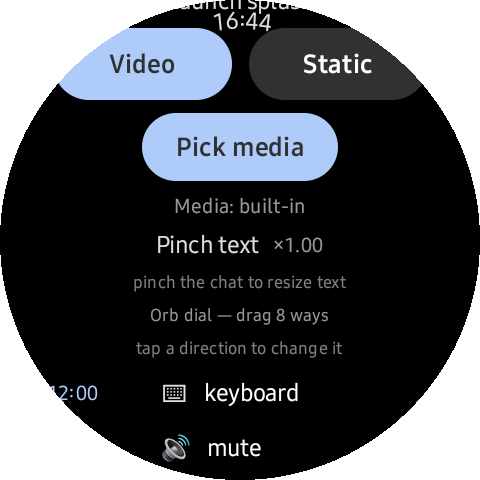 |
| **Settings home** — the Gateways row (two saved, the current one checked, hostname pixelated), Voice out / Voice in / Display / Watch below. Every knob is on-device, and there are no hidden ones. | **Display settings** — markdown toggle, launch-splash modes, pinch-text scale with its live multiplier, and the orb dial's directions right in the list: tap any row to remap that direction. |
| 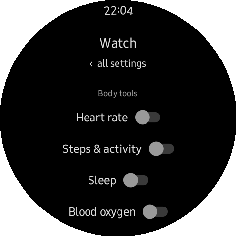 | 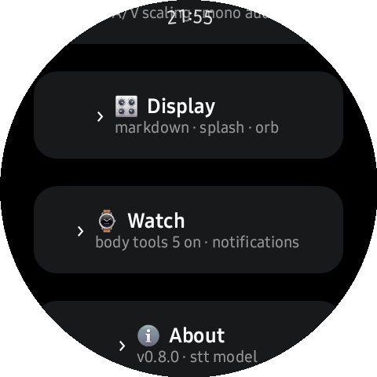 |
| **Body tools, opt-in** — heart rate and steps behind independent toggles, all default off; the truth about each signal is in the table below. | **Settings tail** — the scroll ends where the diagnostics begin: the About row stamps the shipped version and opens the full page. |
| 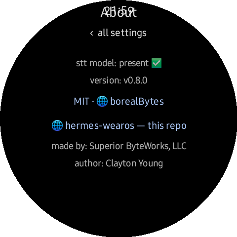 |  |
| **Support without a support line** — Settings ends in an About page that states its own truth: shipped version, STT model presence, license, and who made it; when something is off, you read it there, on the wrist, offline. | **Splash modes are yours** — Settings ▸ Display: the built-in film, a static frame, your own picked media, or none at all. Markdown, launch splash, and the orb live on this one page. |
|  | **A cold start opens on a moving film frame** — the intro film plays and the app *reveals itself mid-motion inside the film* (`revealIsMoving`, one clean cut), so the splash is a doorway, not a wallpaper. **Tap anywhere while it plays and you're in.** And the film is strictly for fun: the owner's first fully AI-generated video, made locally end to end (Qwen Image stills, MiniMax motion, stitched on the same box) — and it has audio. Fun. |

Plus: gateway notifications with approve buttons (above), a GBoard prompt editor for long asks
(with a big `Send`), and a diagnostics screen in Settings.

## How the orb works

The orb is the **only control** on the chat screen — every button that used to crowd the dial
became a drag direction instead:

- **Tap** — listen. The orb warms up and transcribes as you speak (on-device Vosk); a pause sends
  it, a second tap mid-speech cancels the half-sentence.
- **Tap while an answer streams** — stop the run. The orb burns red while the gateway is working;
  one press cancels the *server-side* run, not just the UI. It also burns red **while it speaks** —
  there a tap just mutes (the answer already landed), and a press-and-hold in either state pops the
  dial ring in place so you can grab the keyboard or a `/steer` mid-answer without stopping anything.
- **Press, hold, drag** — the dial. Hold the disc for a beat and a ring appears around it: nine
  wedges, each with an icon and a label. Keep your finger down and slide around the ring — the lane
  under your finger highlights — and **whatever lane you're on when you let go is the one that
  fires.** The ring is up in under 100 ms and the icons sit outside the activation gate, so once
  you've learned the map it's a blind flick.

The nine directions, on the default map (clock-face — every one remappable, and `off` blanks a
direction so an accidental drag does nothing; keyboard is pinned at 12:00 — fastest reach for the
most-used lane):

| Clock | Lane | Release does… |
|---|---|---|
| 12:00 | ⌨ **keyboard** | opens the text editor — type it, or use the keyboard's own mic |
| 1:20 | 🔊 **mute** | toggles spoken replies (TTS is on by default); dwell 2 s here and the ring becomes a volume slider for THIS agent |
| 2:40 | ⚙ **settings** | straight to Settings — because getting there otherwise is a finger-crawl (`record` → hi-fi whisper STT lives on as a remap lane, roadmap in progress) |
| 4:00 | 🧠 **model** | per-chat model picker — lists only what your gateway has enabled; the pick is remembered for that chat, and "gateway default" hands it back |
| 5:20 | ⌘ **commands** | the searchable slash-command overlay (gateway catalog + your recents) |
| 6:40 | 💬 **chats** | your chat list for the current agent |
| 8:00 | ≡ **sessions** | the session browser — adopt desktop sessions, fork, archive, delete |
| 9:20 | 👤 **agents** | the agent picker — persona, tools, session space, and gateway key swap together |
| 10:40 | ✅ **approvals** | the approval-mode sheet for THIS chat — inherit, manual, smart, off |

Remap any direction at **Settings ▸ Display ▸ Orb dial** — tap a direction's row and it advances to
the next action. The chat reads the change live: the very next flick obeys the new map, and the ring
icons redraw with it.

## The back button never quits

Physical **back** is a loop, not an exit (owner batch 6: *"chat to sessions to agents, then back to
chat again — the app shouldn't really quit unless I hit the home button"*):

- **Deep in something** — a sheet, the keyboard editor, the agent picker, the ⌘ overlay, an image
  viewer — back closes exactly that one layer, topmost first, until you're back on a main screen.
- **On a main screen** — back walks the ring: **Chat → Sessions → Agents → Chat**, forever. The app
  never finishes from back.
- **To leave** — press **home**. And the owner's daily-driver setup: assign **double-press home**
  (Wear settings) to open Hermes — wrist up, two taps, and you're back in your last session mid-
  thought, ready to ask. New session when you want one is two taps and a tap.

## Anatomy of a round trip


Three moving parts (plus the plugin, which is really the fourth):

| Piece | What it is |
|---|---|
| `app/` | The watch app. Kotlin, Wear Compose, OkHttp/SSE, the embedded tailnet node. No Google services, no Firebase, no push. |
| `hermes-plugin/` | The **Hermes Wear Kit** plugin: pairing (PIN → claim → enrollment packet), `watch_*` tools, `/pair`, a `hermes watch` CLI, readiness checks, and the Desktop Wear Kit pane. Details in [hermes-plugin/README.md](hermes-plugin/README.md). The catalog installs pin [borealBytes/hermes-wearos-plugin](https://github.com/borealBytes/hermes-wearos-plugin) — a subtree-split mirror of this directory, zero human commits, force-published by this repo's own CI (`.github/workflows/plugin-sync.yml`); the monorepo stays the only place code is written. |
| Hermes gateway | Any Hermes install: point the plugin at a profile (e.g. `wear`) with a persona, tools, and an API key. SSE run streaming + cancel. |
| `server/watchkit/` | Optional zero-dependency Node daemon: mermaid → PNG, full-res `/img` serving from allow-listed roots (GIFs verbatim — the animation survives), `/media` pre-shrink (H.264+AAC / Ogg-Opus) so clips stream smooth on wrist Wi-Fi, opt-in body-tool snapshot cache (+ MCP for the agent), cron/job probes. A render sidecar — never in the run path (SPEC §12.13). The plugin's in-process media lane is porting; the sidecar is the documented fallback. |

### Who owns what — and why a plugin at all

The watch app could, in principle, ship you a URL bar and a token field and call it done. That is
exactly the old life, and it is why the plugin exists: **everything the watch should never have to
know about your tailnet lives on the gateway side of the line.** A Tailscale API token is an
admin-grade credential — minting keys, tagging nodes, patching ACLs — and a Galaxy Watch is the
wrong place to paste one. The plugin keeps that credential on your box, where Hermes already keeps
secrets, and hands the watch a key that is single-use, tag-restricted, and dead the moment
enrollment finishes. Pairing becomes the only ceremony: six digits on the glass, one `pair` to
Hermes, done — no console, no copy-paste, no phone app.

| | **The plugin owns** (`hermes-plugin/`, on your gateway box) | **The watch owns** (`app/`, Wear APK) |
|---|---|---|
| Trust | The Tailscale credential; minting single-use pre-authorized `tag:hermes-watch` keys; the ACL grants (tagOwners + funnel attr) that make enrollment self-serve and narrow | The node identity it earns from that one key — and nothing else; it never sees an API token |
| Pairing | The PIN ledger (5-min TTL, one claim, rate limits), the Funnel claim door (`/pair/*`, port 42653 loopback), the wizard (`hermes watch setup --fix …`) with per-node funnel links | Showing the 6-digit PIN, one handle field, the Knock button — and collecting the enrollment packet exactly once |
| Transport | — (out of the data path entirely) | The embedded tsnet node: every REST/SSE call rides the watch's own WireGuard leg; loopback SOCKS5 shim; failover probe |
| The agent relationship | Profile routing (`/p/wear`), per-profile API keys, session tools (`watch_sessions_*`, `watch_status`…), the Desktop Wear Kit pane, `hermes watch` CLI, readiness lights | The conversation: streaming markdown, the orb, approvals UI, on-device Vosk STT + TTS, media rendering, body tools |
| Media | Telling the watch where watchkit is (ports ride the packet) | Rendering; and — being ported into the plugin — in-process image/GIF/video pre-shrink so the Node sidecar becomes optional |

Read the middle column as the security story: the plugin is the **provisioner and the bouncer**;
the APK is the **resident**. The resident can be thrown out (reinstall, factory reset) and let back
in with a PIN, and nothing the attacker holds from the watch ever outlives a single enrollment.

## Networking: the watch's own tailnet node is the transport

The app embeds a real Tailscale node (`tsnet`, no system Tailscale needed on the watch or a phone).
Since the plugin era, **pairing is the enrollment**: the watch's PIN claim hands it a *single-use*
enrollment key (24 h default lifetime, zeroed from the plugin's ledger the moment the watch collects
its packet), and the node enrolls once — no reusable keys lying around. The manual path (Settings ▸
Gateways ▸ Tailnet, one reusable authkey from the admin console) still works and is what
`scripts/setup.sh` drives for agent installs. From enrollment on, **every** call — REST, answer
streams, image fetches, the STT WebSocket — leaves the watch through a private WireGuard tunnel to
your gateway, over any Wi-Fi. No LAN requirement, no phone in the path, no third-party relay: your
tailnet is the network. The full decision record is [docs/SPEC.md](docs/SPEC.md) §11.4 — owner
doctrine: *"tailnet only, always."*

The watch still keeps an ordered list of gateway endpoints (probe, pick, sticky winner — so a
second tailnet FQDN or a LAN literal reached *through* the tunnel can serve as fallback) — and
everything is visible and editable on the watch: Settings ▸ Gateways is a real multi-gateway
manager, not a single URL box. Tailnet truth lives one level down in Settings ▸ Gateways ▸
Tailnet: node name, key, live phase, and a Test button that health-checks the gateway through
the exact tunnel an ask rides:


| Piece | You get | Setup |
|---|---|---|
| **Watch node** (`<watch-name>.<your-tailnet>.ts.net`) | answers from anywhere with Wi-Fi | paired via the PIN ceremony — or, manual path, mint a *reusable, non-ephemeral* authkey (admin ▸ Keys) and hand it over once |
| **Gateway** (`http://<gateway-fqdn>.ts.net:8642`) | the API the watch rides the tunnel to | run `tailscale` on the gateway box; nothing else — tailscaled accepts tunnel traffic itself (MagicDNS on; one Funnel rule for `/pair/*` during pairing, by the wizard) |
| **LAN literal** (`http://192.168.1.50:8642`) | optional extra endpoint | reached THROUGH the tunnel too; useful only with the dev escape hatch (`tailnet_on off`) |

The old model — watch outside the tailnet, reaching `.ts.net` names only when the *router* did
the resolving, LAN at home as fallback — is retired; SPEC §11.4 keeps the full decision record.

Inside the gateway manager, every saved gateway is a row — here the owner's box (its hostname
pixelated, per this repo's own privacy rule) and a parked LAN-literal fallback, each with its
live probe dot, the current auto-selected winner marked, the transport line above
(`wifi(wlan0) · validated`), and the active endpoint's editor beginning below:


The gateways manager is a real registry — several gateways saved, one winner dot chosen by the
health probe, failover in seconds — and underneath it the **agent-key matrix**: a ✓/— per profile,
learned from watchkit's read of the profiles' `.env`s (re-learned on a self-timed sweep, so a newly
created agent is asking-ready before you ever tap it). Agents without a key still list their
sessions; asking them needs the key:

 

## The Wear Kit pane

Installed into the Hermes desktop app, the plugin adds a **Wear Kit** page — a right-side pane
whose whole job is a four-step checklist:

1. **Install the APK** — a direct link to
   [GitHub Releases](https://github.com/borealBytes/hermes-wearos/releases/latest) and the
   [repo](https://github.com/borealBytes/hermes-wearos).
2. **Enable Wear Kit for your agents** — one checkbox per profile, plus an **Enable all** row
   on top (enable all, then uncheck who should *not* talk to the watch — the CLI equivalent is
   `hermes watch enable --agents all`).
3. **Open the app on the watch** — it greets you with a big 6-digit PIN (5-minute window, single
   use; a `show PIN` button mints one plugin-side for when the watch isn't in your hand).
4. **Say or type `/pair 123456`** — swap in the PIN on the watch and say it to Hermes on ANY
   surface, or run `hermes watch pair`. The watch gets its tunnel enrollment packet and is yours.

Below the checklist: the paired-device list and the **readiness lights** (tailscaled, credential,
MagicDNS, funnel) — every red light names its fix verb, and `hermes watch setup` prints the same
list as JSON. The pane talks to the plugin's own REST half (`dashboard/plugin_api.py` mounted at
`/api/plugins/wearos/*`, read pane-side with `ctx.rest`) — and that mount is **hot**: installing or
updating the plugin makes the backend answer the very next request, no app restart. (A pane only
needs the card's **Rescan** to pick up fresh JS; a row stuck on *"copying…"* is core's
pending-sync state, and Rescan lands it too.) The checkbox writes the same `config.yaml` ledger
core's card toggle edits one agent at a time — and it's the same list `hermes watch enable` drives.
The web dashboard shows the same plugin as a plain management tile
(Disable / Remove, *"No dashboard tab"* — honestly: this plugin's page is the Desktop pane, not
a web page; `/api/plugins/wearos/*` is an API namespace, not a tab).

The real config form (Settings ▸ Plugins ▸ wearos) is generated from the plugin's `config_schema`,
descriptions included; secret fields render blank even when set — they are never echoed back. Full
config table in [hermes-plugin/README.md](hermes-plugin/README.md).

### Fresh gateway in a VM

Every shot in this subsection was generated by `scripts/docs-vm/` — a throwaway Ubuntu VM, Hermes
installed fresh from the official installer, the plugin rsynced in, and the tailnet joined with an
ephemeral single-use key: **born clean, not masked over** (that's why there are no pixelated boxes
on these). The terminal shots are re-renderings of the verbatim CLI/curl output, not photos of a
terminal.

| | |
|---|---|
|  |  |
| **A brand-new install's Plugins page** (Settings ▸ **Plugins**): the `wearos` row is the only user-source plugin on the box. The left nav grows a `wearos` sub-entry; the row and the **Manage plugins →** link both land on the Wear Kit pane — the config form two shots below is exactly what that click opens. The card legitimately says "No dashboard tab". | **`hermes watch setup` before any credential** — verbatim wizard JSON: red lights, each with its fix hint. Nothing invented for the camera. |
|  |  |
| **Tailnet joined, funnel up, no watch yet** — all green except `devices_online: 0 paired`. Honest state, honest screenshot. | **The whole ceremony, start to finish** — mint PIN → watch knocks `POST /pair/claim` → `hermes watch pair <PIN>` claims → the packet is collected ONCE (the second GET gets 410). Single-use by construction. |
|  |  |
| **After the ceremony** — all green, `1 paired`, and the device row from `hermes watch devices`. | **The real plugin config form** (Settings ▸ Plugins ▸ wearos), rendered from `config_schema` — secret fields empty by design. |

### By hand

No plugin? The watch still speaks plain Hermes: point it at any profile's API server with that
profile's `API_SERVER_KEY` bearer. Persona: copy `docs/wear-SOUL.example.md` to
`~/.hermes/profiles/wear/SOUL.md` (or `scripts/setup.sh --install-soul`) — it teaches the agent to
answer short, mark down-lite, unicode math, never LaTeX, and to render mermaid as fence blocks.
Start the optional watchkit helper with `scripts/watchkit.sh` or the bundled
`server/watchkit/hermes-watchkit.service`.

## Voice, honestly

There is no free, offline, *perfect* STT on a watch today. The Voice-in page offers three honest
paths (and one keyboard back door):

| Path (the picker's own words) | Where audio goes | Quality | Default |
|---|---|---|---|
| **Local Vosk · offline** | never leaves the watch | Best-effort on-device. Nails short commands and dictation you speak *at* it; garbles names and mumbles. Clear speech, or edit-and-resend. Needs the model — one tap on Voice in installs it from your gateway (41 MB, resumable). | ✅ default |
| **OFF-DEVICE · vendor (Google or Samsung)** | the vendor's cloud — whatever recognizer your watch ships | Usually the best raw accuracy on the watch, at the cost of the vendor hearing it. The picker says **OFF-DEVICE** even when the vendor caches locally — that's deliberate. | your choice |
| **Gateway · whisper** (`watchkit /stt/whisper`) | your own box, through your own tunnel (the mic clip rides as **Opus**, AAC fallback — watchkit sniffs the container) | Noticeably better than Vosk — but buffered: the final text lands when you stop talking. Model choice is a row on the Voice page. | opt-in |
| **Gateway · parakeet** (streaming) | your own box, through your own tunnel (same Opus wire) | `scripts/parakeet.sh` sets the model up for you (Parakeet Unified EN 0.6b, GGUF, no GPU). Its edge over a built-in Hermes whisper is **streaming**: partials flow back while you talk, at the latency of you↔your gateway, so the transcript is nearly finished when your sentence is. | opt-in |
| GBoard typing → its mic | Google's cloud | Best raw accuracy available on the watch — at the cost of Google hearing it. | your choice |

TTS is the opposite story: Android's on-device TTS is default **on**, so replies come back *spoken*
without touching a cloud voice. Mute is one dial flick (drag the orb toward 1:20) — the orb is the
*only* control on the chat screen: nine drag directions stand in for every button, and the ⌘ lane
at 5:20 opens the slash overlay. Reply loudness is PER AGENT — the Voice page slider, the mute-lane
dwell slider on the dial, and the satellite all ride the same per-agent store. While it reads aloud,
the chat keeps the SPOKEN sentence in view (karaoke follow); and a fresh reply rests just above the
orb from sentence one, growing upward, instead of starting at the top of the circle.

## What it weighs — and why it never grows

Measured today on the shipped debug build (the R8 hardening pass is on the roadmap; the Release
APK in GitHub Releases is CI-signed and zipaligned): **105,906,088 bytes — ≈106 MB** — and the
APK's own entries say what that is made of:

| What | Size | Honest footnote |
|---|---|---|
| dex (your code, unshrunk) | ~41 MB | debug builds skip R8 entirely — this is the fat part, and the roadmap's release pass shrinks it hardest |
| embedded tailnet node (`libgojni.so` — tsnet via gomobile, 2 ABIs) | ~44 MB | the price of "no LAN, no phone, no relay": a real WireGuard node in the app; the watch's `armeabi-v7a` slice alone is 21 MB |
| Vosk JNI (`libvosk.so`, 2 ABIs) | ~18 MB | the STT engine binary; x86_64 rides the emulator build for free |
| splash intro film (`hermes-watch-intro.mp4`) | 0.9 MB | yes, the fun part is under a megabyte |
| resources + everything else | ~2 MB | media3, Compose, the lot |

Optional pieces live OUTSIDE the APK: the Vosk acoustic model (41 MB zip → 69 MB unpacked) rides
into the app's files dir one tap at a time from Settings ▸ Voice in — streamed from your own
gateway's cache, Range-resumable, marker-verified before the tree swaps (see the sequence above).
`scripts/get-vosk-model.sh` remains the adb path for scripted setups; both write the same tree.
Deleting it just falls back to vendor/gateway STT, and the Voice-in card says which state you're in.

**The part watches usually die of — cache creep — doesn't exist here.** The app writes no disk
cache at all (the entire `cache/` dir after a full day of streaming, images, and voice: **25 KB**):
mermaid and image cards render from streamed bytes held in memory, custom splash media is read
*in place* through its persistable URI (never copied), and the body-snapshot cache is server-side
on your watchkit with a freshness cap — expiring on the gateway, not on your wrist. Chat history
lives where chat history belongs: in the gateway's session store, of which the watch keeps nothing
but the session id it's riding. Six months from install, the app's footprint is the same
kilobytes it shipped with. The only thing that can grow your watch's storage is the next app you
install.

## Body tools (opt-in, owner-off by default)

The watch can feed its own sensors to the agent — behind independent toggles, all default **off**.
Stated with zero marketing:

| Tool | Today, on the Galaxy Watch this was built against | Data path |
|---|---|---|
| `watch_heart_rate` | ✅ works — streams what Health Services actually delivers | Health Services → signed snapshot → gateway → agent |
| `watch_steps` | ✅ works — same, with daily counter semantics | same |
| `watch_location` | one-shot GPS fix (fresh on chat-ask, last-known on timers) | watch GPS → snapshot |
| `watch_spo2` · `watch_sleep` | ⚠️ **toggle is live; data is not** — Samsung's Health Services exposes neither to Wear apps, so the toggle flips and nothing arrives | wiring complete, source silent |
| auto-attach digest | piggybacks the digest on each ask, battery-aware | snapshot → ask body |

Snapshots are pushed over TLS to *your* watchkit, cached server-side with a freshness cap, and exposed
to the agent as both MCP-style tools and raw JSON. Nothing is forwarded anywhere else. The `DataType`
constants are matched tolerantly (real-world crashes taught us that), so the moment a device *does*
expose SpO2 or sleep it surfaces with no watch update. On non-Samsung vendors the toggles simply
report "vendor not available" and everything else keeps working.

The ⚠️ rows are a target, not a resignation: the plan for blood oxygen, sleep, and every other signal
Samsung keeps behind its own apps is to **reverse-engineer the vendor channels** until they talk.
The goal is honestly greedy — pull in every measurement this watch is physically capable of, whether
Health Services offers it politely or not. Until then the toggles tell the truth: wired, waiting,
quiet.

## Privacy

- **Audio stays on-device** in the default config (Vosk). Whisper fallback sends audio to *your*
  gateway only. GBoard's mic is Google — documented, opt-in.
- **TTS is on-device** by default (no cloud voice calls).
- Text + run streaming go **only** to your configured gateways, through the watch's own tailnet
  node (SPEC §11.4) — no relay, no companion app, no LAN requirement.
- **Pairing leaks nothing reusable:** the 6-digit PIN is 5-minute and single-claim; the enrollment
  key it returns is single-use and zeroed from the plugin's ledger once collected. The only public
  surface is the claim door, Funnel-fronted at `/pair/*` alone (SPEC +
  [hermes-plugin/README.md](hermes-plugin/README.md) disclosure).
- On-watch cache is **encrypted at rest and size-bounded**; delete = app data wipe.
- Body data flows **only** when you flip the toggles; snapshots push to your watchkit, nowhere else.
- No analytics. No crash reporter. No push tokens. `grep` for tracking SDKs: nothing.

## Develop — and let your agent install it

This repo is built to be installed by *your AI coding agent* (the file `AGENTS.md` is its contract,
`CONTRIBUTING.md` the developer rules — read them to your agent, or let it read the repo). Paste
this into OpenCode / Claude Code / Codex at your gateway machine:

```text
Install this for me: git clone https://github.com/borealBytes/hermes-wearos && cd hermes-wearos
Read AGENTS.md and follow it end to end: bootstrap the toolchain, build the APK, configure
watchos.config.json from my Hermes profiles, install to the watch (wireless debug — expect the
port to rotate, use the chunked-push recipe), then verify health + one ask end to end. Interview
me only for what you cannot detect.
```

The script equivalent, if you prefer doing it by hand:

```bash
scripts/bootstrap.sh                    # JDK + Android SDK + gradle, folder-local, no root
cp watchos.config.example.json watchos.config.json   # your endpoints + token (gitignored)
scripts/setup.sh                        # build → install → push config → health-check
```

`setup.sh` knows the ugly parts: wireless-debug port rotation on real watches, chunked
`split -n l/14` installs with md5 verification (single-pipe pushes on flaky wifi links die mid-flight),
`svc power stayon` + `deviceidle disable` hardening, and token auto-detect from
`~/.hermes/profiles/wear/.env` when the gateway is this same machine. `--dry-run` shows the plan first.

<details>
<summary>What <code>AGENTS.md</code> covers (the contract your agent gets)</summary>

- prereq detection (JDK, SDK, adb, optional emulator via `scripts/emulator.sh`)
- interview *only* unknowables (endpoints, which profile); auto-detect tailscale FQDN, `API_SERVER_KEY`
- the real-watch install recipe (port rotation warning, hardening one-liners, chunked push + md5)
- config push over `DevAskReceiver` debug extras (token, gateways, watchkit, tailnet key, brief job id)
- verify checklist: `/health` 200, one streamed ask round-trip, one screenshot
- troubleshooting table (offline device ⇒ rotated port; EOF pushes ⇒ chunked; degraded sessions row, etc.)

</details>

Day-to-day on the bench:

```bash
source scripts/env.sh
../devkit/gradle/current/bin/gradle :app:assembleDebug :app:testDebugUnitTest   # JVM-only, no device
python3 -m pytest hermes-plugin/tests/                    # the plugin suite (stdlib + pytest only)
scripts/emulator.sh                        # optional headless Wear emulator
scripts/doctor.sh                          # toolchain + link health report
```

- `docs/SPEC.md` — the full architecture spec **and Appendix A: an unexpurgated build log** (every
  trap hit: Wear Compose 1.4.1 quirks, 32-bit-only watch ABI, Samsung `DataType` name drift, SLC
  anchor fights, flaky wireless debug installs). If you build for watches, read it before fighting the
  same ghosts.
- `docs/DEMO.md` — the living demo-production ledger: every feature mapped to its screenshot **and**
  its beat in the tour film, the README change checklist, capture recipes and the verification
  gates. `scripts/demo-check.sh` enforces the ledger mechanically. Keep it current when features land.
- `app/src/debug/.../DevAskReceiver.kt` — adb-broadcast harness (`-e text '...'`, `-e ptt_demo`,
  `-e fontscale`, `-e agent …`): scriptable end-to-end demos, which is exactly how every screenshot
  in this README was captured.
- `scripts/docs-vm/` — the PII-clean doc-shot pipeline behind the VM pictures above.
- Target: Wear OS 5+ (API 33+); round hardware is the design target, square faces render with
  the corner bonus (see the round-first note up top). Physical-verified on a Galaxy Watch Ultra
  (Wear OS 6, 480×480, 32-bit userspace → `armeabi-v7a`).

## Limitations & roadmap

- [x] **tsnet node in-app** — shipped: the watch joins your tailnet itself (embedded `tsnet` via
      a gomobile shim), and the tunnel is THE transport — no LAN path, no tailscale-enabled router
      required (SPEC §11.4).
- [x] **Hermes Wear Kit plugin** — shipped: catalog install, PIN pairing (`/pair`), single-use
      enrollment keys, the Desktop pane's checklist + readiness lights. The six-digit first-run
      pairing flow this slot used to hold *is* that.
- [ ] **Whisper auto-fallback** wired into the voice loop (endpoint exists today; app-side confidence gate is next).
- [ ] **Blood oxygen + sleep data**: toggles are wired and waiting; Samsung exposes neither to Wear — the path is reverse-engineering the vendor channels (and every other signal the watch can emit that we're not yet pulling).
- [ ] Play-store signing + R8 hardening pass; today it's a debug-build project.
- [ ] Complications + tile. On-wrist launch currently = app icon (or voice link).
- [ ] Wear-side mermaid fallback when the gateway render helper is offline.

## Built with

- **OpenCode** driving development end to end — **against a self-hosted `Qwen3.8-Flash-Next-Uncensored`
  served locally by SGLang**. Yes: this app was mostly written by a local model talking to a local
  agent harness, on the same machine it serves the watch from. The build log in
  `docs/SPEC.md` Appendix A is that collaboration's fossil record. Along the way we studied a few
  reference components of the Wear OS stack — the Wear Compose sample app, Vosk's Android examples,
  Google's watch-assistant demos — purely as learning material: **no code was reused**, everything
  here was written for this app.
- Wear Compose 1.4.1, OkHttp + SSE, `androidx.health`, Vosk, nothing else you'd spot in a
  dependency audit.

## License

MIT — see [LICENSE](LICENSE), and the agent contract in [AGENTS.md](AGENTS.md) / developer rules in
[CONTRIBUTING.md](CONTRIBUTING.md). Screenshots were captured on a physical Galaxy Watch Ultra (and,
for the v0.7.0 batch, the headless Wear OS 5 emulator at the same framebuffer size — the bezel-volume
frame on that build is driven through the exact key path the physical bezel fires); the plugin/VM
shots above are generated by `scripts/docs-vm/` from a throwaway install, born PII-clean; the demo
chats use neutral scripted prompts, and every visible pixel is exactly what the watch showed.
