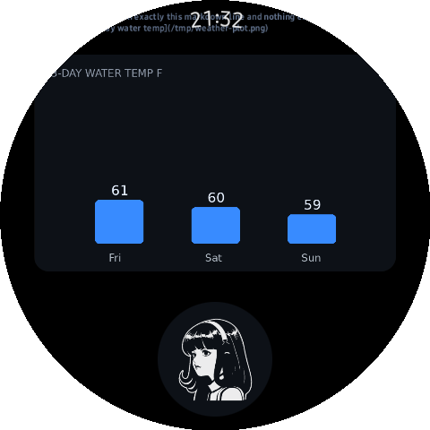
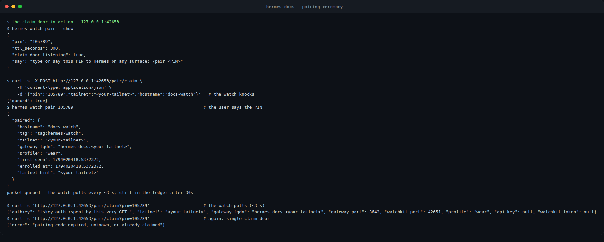
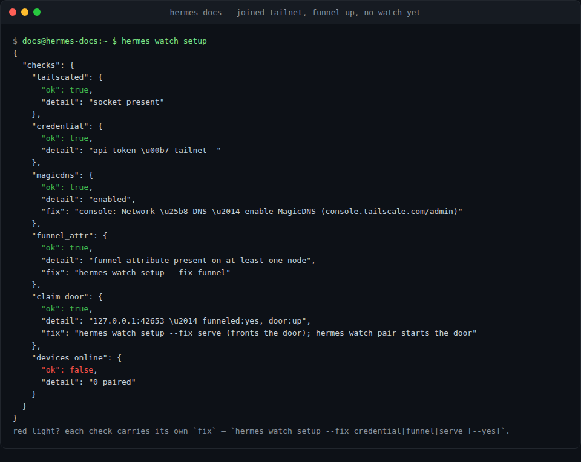

# Hermes Wear Kit

⌚ A voice-first Wear OS client for a self-hosted Hermes gateway — paired over the
**watch's own embedded Tailscale node**. Install once, pair with a 6-digit PIN, done:
no phone app, no relay server, no reusable keys lying around. Every call after pairing —
streamed chat, approvals, images, cron alerts — rides your tailnet. First smartwatch
client in the Hermes catalog.

> ## ⛓️ Where this code lives
>
> **Source of truth:** [borealBytes/hermes-wearos](https://github.com/borealBytes/hermes-wearos) →
> `hermes-plugin/` — every line is edited there, in the monorepo, next to the watch app it serves.
>
> 📸 **The full showcase lives in the [monorepo README](https://github.com/borealBytes/hermes-wearos#readme)** —
> every feature photographed on real glass: the orb dial, streaming answers, in-session approvals
> with ✅/❌ orb flanks, media that animates on your wrist, the round-trip diagrams, the VM
> walkthrough. The six stills in [`docs/screenshots/`](./docs/screenshots) are an appetizer; the
> GIFs don't fit in a subtree split's suitcase.
>
> 📦 **The APK:** [GitHub Releases](https://github.com/borealBytes/hermes-wearos/releases) —
> CI-built with `SHA256SUMS.txt` and GitHub build attestation, never bundled in a repo.
> **Open source forever** — making it yours is the point.
>
> **How it got here:** this repo is a *build artifact of that directory* — a `git subtree split`
> published by the monorepo's own GitHub Actions on every merge
> ([plugin-sync.yml](https://github.com/borealBytes/hermes-wearos/blob/main/.github/workflows/plugin-sync.yml)).
> **Zero human commits: nobody pushes here, nobody opens issues here, nobody hand-edits it.**
> It exists so a catalog install clones a few megabytes instead of the ~113 MB monorepo — same
> code, same license, same CI, tiny clone.
>
> Fix a typo? Wrong door — [open a PR against the monorepo](https://github.com/borealBytes/hermes-wearos/compare)
> and the bot re-publishes this view within the minute.

## Pair a watch — the whole ceremony

```bash
hermes plugins install wearos      # catalog: pinned, reviewed SHA
hermes watch setup                 # wizard: tailscaled → credential → MagicDNS → funnel
hermes watch enable --agents all   # flip the plugin on for every profile in one move
hermes watch pair                  # answers "say this PIN: 105789"
```

1. Install the APK from [GitHub Releases](https://github.com/borealBytes/hermes-wearos/releases)
   onto the watch (min SDK 30 — Galaxy Watch 4 and later).
2. Open it: the glass shows a **6-digit PIN**. That PIN is the entire pairing UX.
3. Say or type the PIN to Hermes — `/pair <PIN>` in any chat surface, `hermes watch pair <PIN>`
   in a terminal, or the `watch_pair` tool. The plugin mints a **single-use** Tailscale
   enrollment key (24 h default, tagged `tag:hermes-watch`), the watch's embedded node
   enrolls into **your** tailnet, and the claim door serves the packet exactly once —
   then 410 forever.
4. Everything after is the tunnel: REST/SSE/WebSocket from the watch straight to your
   gateway's `/p/<profile>` lane. The gateway box runs plain `tailscaled` with MagicDNS;
   no ports, no LAN, no UPnP, no phone.

## What you get installed

The Desktop app gains a **Wear Kit** page
([desktop/plugin.js](./desktop/plugin.js)): a 4-step install checklist (APK → per-profile
enable → watch PIN → `/pair`), paired devices with live tailnet state, readiness lights, and
**a checkbox list of your agents** — per-profile enable/disable in one view. Its data plane is
[dashboard/plugin_api.py](./dashboard/plugin_api.py), a FastAPI router hot-mounted at
`/api/plugins/wearos/*`: install or update answers the next request, no app restart (core's own
hot-mount test proves the seam). The pane never calls tools — the desktop SDK has no tool-call
door (measured on v0.23.0), which is exactly why the REST half exists.

The agent gains four tools: `watch_send` (text/markdown/images to a watch), `watch_status`
(paired devices, per-profile enablement, readiness), `watch_pair`, and `watch_enable`
(idempotent per-profile toggling — see below). And a CLI: `hermes watch
pair|enable|setup|status`.

An agent that has the plugin enabled *permanently* can also be shown here with the card's
per-profile copy. Note core's model: an agent installed with its **own copy** freezes at the
SHA it was copied at, until the card's *Update to pin* moves it — the Wear Kit pane surfaces
those stale pins in red so one plugin never wears three versions silently.

## The gallery (six — the full wall is in the monorepo)



**Images on the wrist.** An agent's matplotlib output arrives as a card; tap it full-screen.
`` lines are the whole protocol.


**Approvals on the glass.** A dangerous tool parks mid-stream; the watch shows the card and
the ✅/❌ orbs flank the dial. Approve from your wrist, the run resumes.



**The ceremony, start to finish.** `hermes watch pair --show` prints the PIN; the watch POSTs
its claim; the packet (authkey, gateway FQDN, ports, profile, API key) is collected once and
the door returns 410 forever after.


**Media that animates.** GIFs stream verbatim through watchkit (or the ported in-process
lane), video pre-shrinks to wrist-friendly H.264. Pinch-zoom included.


**Failover is a first-class screen.** Multiple gateway endpoints, per-agent key map (✓/—),
tunnel state — the whole transport story in-app, nothing baked.



**Honest readiness.** The wizard checks tailscaled, credential, MagicDNS, funnel attr, the
claim door — and every red light names its own `--fix` verb.

## Enablement — one plugin, every agent

On a multiplexing gateway every profile is its own agent with its own `plugins.enabled` list.
One plugin instance pairs every watch for the whole gateway; enable it wherever `watch_*` and
`/pair` should answer — all profiles is fine and normal:

```bash
hermes watch enable --agents all              # every profile, idempotent
hermes watch enable --agents wear,wear-demo   # or a comma list
hermes watch enable --agents wear --disable   # back off again
```

The same surface is a tool — `watch_enable {"agents": ["wear", …] | "all", "enable": true}` —
and a checkbox list on the pane. What it writes into each profile's `config.yaml` is a
**minimal line-level edit**, never a YAML round-trip: your comments, key order, blank lines
and CRLF survive. Enable adds the list item (creating a small `plugins:` block only where
absent) and sets `plugins.entries.wearos.settings.gateway_profile` **if missing** — a value
you set is never overwritten. Disable removes only the list item. Edits take effect when that
profile's agent (re)loads plugins.

Settings live under the profile's `plugins.entries.wearos.settings`; the Desktop form at
Settings ▸ Plugins ▸ wearos is generated from the schema below. Secret fields deliberately
render blank even when set — they are never echoed back.

## Config options ([plugin.yaml](./plugin.yaml) → `config_schema`)

| Key | Type | Default | Notes |
|---|---|---|---|
| `tailnet` | str | — | Tailnet handle as shown in the admin console; validated live before anything is minted. May stay empty — the handle rides the watch's claim request. |
| `tailscale_api_token` | secret | — | Owner/Admin API token. **Either this or the OAuth pair below.** |
| `tailscale_oauth_client_id` | str | — | Preferred credential: scope to `auth_keys` + `devices:core`, restrict to the watch tag. |
| `tailscale_oauth_client_secret` | secret | — | Secret for the OAuth client (client_credentials flow). |
| `watch_tag` | str | `tag:hermes-watch` | ACL tag stamped on every enrolled watch node (ACL hygiene). |
| `key_expiry` | str | `24h` | Lifetime of the single-use enrollment key. |
| `gateway_profile` | str | `wear` | Hermes profile the watch binds to (its `/p/<profile>` lane + API key). |
| `gateway_api_key` | secret | — | Fallback for the packet's `api_key`; normally resolved from the profile's own `API_SERVER_KEY` via its secret scope. |
| `watchkit_token` | secret | — | Optional helper-sidecar bearer for the watch (nullable packet field — leave unset with no sidecar). |
| `claim_port` | int | `42653` | Loopback port of the funnel-facing claim door (127.0.0.1 only). |
| `apk_release_url` | str | `…releases/latest` | Where "install the watch app" points. |

Where state lives: install dir `~/.hermes/plugins/wearos/`; device registry + PIN ledger in
one profile-scoped `state.json` under `~/.hermes/plugin-data/`, mode 0600; the claim door is
one in-process daemon thread on the loopback port above.

## The claim door (pairing API)

[claim_server.py](./claim_server.py) is the ONE pre-enrollment network surface: loopback HTTP,
`127.0.0.1:42653`. On the box, `tailscale serve --bg --https=443 --funnel /pair/*` fronts it;
nothing else is exposed. No bearer — the 6-digit PIN, single-claim, and rate limits ARE the
auth. The watch client is built against exactly this:

```
POST /pair/claim   {"pin":"123456","tailnet":"<handle>","hostname":"<watch name>"}
                   → 202 queued · wrong/expired/consumed 410 · rate-hot 429
GET  /pair/claim?pin=123456
                   → 204 until a human claims · 200 + packet ONCE · then 410 forever

packet = {authkey, tailnet, gateway_fqdn, gateway_port: 8642, watchkit_port: 42651,
          profile, api_key, watchkit_token}                     # nullable fields pinned
```

`api_key` resolution order: the gateway profile's own `API_SERVER_KEY` (bound secret scope),
then the ambient scope (single-profile installs), then the declared `gateway_api_key` secret.
The enrollment key is zeroed from the ledger the moment the watch collects it; re-pair updates
the device record in place (`re_enrolled_at`).

## Wizard fix-verbs

`hermes watch setup` prints the readiness checklist (see the screenshot above); every red
light names its fix. `--fix credential` live-validates the OAuth pair / token and shows the
discovered tailnet handle. `--fix funnel` detects the `funnel` node attr in the ACL and,
behind an explicit preview→approve, PATCHes the one rule (JSON policies; huJSON tails get a
console diff, never a blind write). `--fix serve` reads `tailscale serve status` read-only
and **prints** the command — the wizard never executes system changes itself.

## Requirements

- A **Tailscale account + tailnet** reachable from the Hermes host (`tailscaled` + MagicDNS).
  No Tailscale yet? `hermes watch setup` walks you through it, including an official-source
  installer fetch pinned by checksum.
- An **OAuth client** (recommended; `auth_keys` + `devices:core`, scoped to the watch tag) or
  an Owner/Admin **API token**, entered as plugin secrets — never a file the plugin opens.
- Funnel enabled on the gateway node, exposing only `/pair/*` (the wizard fixes the ACL).
- `requires_hermes >= 0.23.0` — the pane data plane (`ctx.rest` + hot-mounted
  `plugin_api.py`) is measured on v0.23.0.

## Disclosure (catalog rule 13)

- **Third-party calls:** `api.tailscale.com` — device list, DNS preferences, ACL read +
  single-rule patch, key mint/expire ([methods](./tailscale.py)) — during `hermes watch
  pair|status|setup` and the load-time readiness pass. ACL writes happen only behind an
  explicit preview→approve.
- **Public exposure:** Funnel serves **`/pair/*` only** on :443 — the claim endpoint above.
  All chat traffic, media and notifications ride the private tailnet.
- **Secrets:** through Hermes routes only (rule 11): declared `config_schema` secrets read
  via the profile's secret scope / `get_secret`. The plugin never reads `.env` files,
  `auth.json`, keychains or another tool's credential store, and stores no per-watch tokens —
  enrollment keys are single-use and zeroed at collect.
- **State on disk:** one profile-scoped `state.json` under `~/.hermes/plugin-data/`
  (registry, PIN ledger, tombstone), mode 0600. Nothing else.
- **Background:** one in-process daemon thread (the loopback claim door, opened at plugin
  load, closed at unload). No subprocesses are run by pairing; the wizard prints system
  commands, never executes them. At setup *you* may approve the official Tailscale installer
  (upstream source, pinned checksum, disclosed before running).
- **No self-updater (rule 3):** the plugin fetches no code for itself. Updates arrive only
  through a catalog SHA-bump PR plus `hermes plugins update wearos`.
- **Optional Node sidecar:** the media lane (mermaid/images/audio pre-shrink) still falls
  back to the documented watchkit daemon (`scripts/watchkit.sh` in the monorepo) until the
  in-process port lands; this plugin does not install or update it.

## Tests

From this plugin root: `python3 -m pytest tests/` (stdlib + pytest; no device, no network —
the suite sandboxes `HERMES_HOME` into a tmp dir, fakes the Tailscale API, and speaks real
HTTP to an ephemeral claim door). Hermes host modules resolve from `~/.hermes/hermes-agent`
or `$HERMES_AGENT_ROOT`. From the monorepo the same command is
`python3 -m pytest hermes-plugin/tests/`.

## Layout

| File | Role |
|---|---|
| [plugin.yaml](./plugin.yaml) | manifest (capabilities verified against hermes-agent v0.23.0) |
| [\_\_init\_\_.py](./__init__.py) | pairing state machine, claim + registry, four tools, `/pair`, `hermes watch` CLI |
| [claim_server.py](./claim_server.py) | the funnel claim door (stdlib ThreadingHTTPServer, 127.0.0.1) |
| [tailscale.py](./tailscale.py) | stdlib-only Management API client (key mint/expire, DNS, ACL + funnel attr) |
| [media.py](./media.py) | in-process media lane (porting; the sidecar is the documented fallback) |
| [dashboard/](./dashboard/) | the pane's data plane: FastAPI router hot-mounted at `/api/plugins/wearos/*` |
| [desktop/plugin.js](./desktop/plugin.js) | Wear Kit page: 4-step checklist, agent checkboxes, devices, readiness lights (inline SVG wordmark — the loader serves no sibling assets) |
| [docs/screenshots/](./docs/screenshots/) | the six stills above — catalog gallery |
| [tests/](./tests/) | pytest suite (state machine, claim API over real HTTP, ACL detect, registry, pane routes) |

Architecture prose: [SPEC §11 (endpoints) and §11.4 (embedded tailnet — the transport)](https://github.com/borealBytes/hermes-wearos/blob/main/docs/SPEC.md)
in the monorepo.
