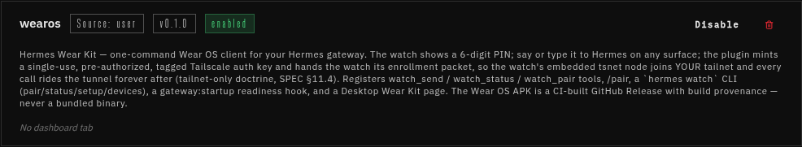

# Hermes Wear Kit (plugin)

The Hermes-side of [hermes-wearos](../README.md): install once, pair a watch with a
6-digit PIN, done. The watch app lives on the watch and enrolls into **your own
tailnet** with its embedded Tailscale node — no LAN transport, no phone relay, no
reusable keys lying around. Everything after pairing rides the tunnel (SPEC §11.4).

The easy path on a real box, end to end:

```bash
hermes plugins install wearos     # catalog entry → pinned, reviewed SHA
hermes watch enable --agents all  # one command flips the plugin on for every profile
hermes watch setup                # wizard: tailscaled → credential → MagicDNS → funnel
hermes watch pair                 # or: /pair <PIN> in any Hermes chat surface
```

1. Install the APK from [GitHub Releases](https://github.com/borealBytes/hermes-wearos/releases/latest)
   (CI-built, SHA256SUMS + attestation) onto the watch.
2. Open it on the watch — it shows a **6-digit PIN**.
3. Say or type `/pair <PIN>` to Hermes — boom, paired. The repo is
   [borealBytes/hermes-wearos](https://github.com/borealBytes/hermes-wearos).

## Installed — what it looks like, and where config lives

The dashboard's **Plugins** page is where an installed plugin shows up: name, source,
version, an `enabled` chip, the description, and Disable / Remove controls.



The card is a management tile ("No dashboard tab" is the core UI saying this plugin
doesn't ship a *web-dashboard* page — the Wear Kit's page lives in the Desktop
workspace: a 4-step install checklist (APK → per-profile enable → watch PIN → `/pair`),
paired devices, and readiness lights).

**The config editor is in the Desktop app: Settings ▸ Plugins ▸ wearos.** The form is
generated from `config_schema` below, descriptions included. Three things about that
page that read confusingly until you know core's model:

- **"Applies to" chips = profiles.** On a multiplexing gateway every profile is its own
  agent with its own `plugins.enabled` list, settings block, and `.env`. The chip row
  picks which profile you're editing; a profile where the plugin isn't enabled shows
  *"No plugin has settings yet"* — enable it there first (the toggle on the plugin's
  card, or the `plugins:` block in that profile's `config.yaml`) — or skip that drop-down
  dance entirely: **`hermes watch enable --agents all`** (or the Wear Kit pane's step-2
  checkboxes, ENABLE ALL on top) toggles it for every profile in one move. One plugin
  instance pairs every watch for the whole gateway, so enable it wherever you want
  `watch_*` tools and `/pair` to answer — enabling it for *all* profiles is fine and
  normal.
- **Secret fields render blank even when set** — they are never echoed back
  ("leave blank to keep the current value"). `type: secret` values live in the active
  profile's `.env` and are read through Hermes's `get_secret`; they never appear in
  config.yaml or logs. `hermes watch setup` seeds them under the raw schema key names.
- **`tailnet` may stay empty.** The handle arrives inside the watch's claim request and
  is validated live against the Tailscale API before anything is minted; the wizard
  (`--fix credential`) prints the discovered handle if you want it pinned in settings.

Under the hood, settings land in the profile's `config.yaml`:

```yaml
# ~/.hermes/config.yaml  (or profiles/<name>/config.yaml)
plugins:
  enabled: [wearos]
  entries:
    wearos:
      settings:
        gateway_profile: wear-demo
```

### Enabling it per profile — `watch_enable` / `hermes watch enable`

The confusing single-select profile drop-down in core has a replacement: one verb (and a
checklist in the Desktop pane) that toggles the wearos plugin **per profile**, idempotently:

```bash
hermes watch enable --agents all                # default: every profile (named + default root)
hermes watch enable --agents wear,wear-demo     # or a comma list
hermes watch enable --agents wear --disable     # remove it from that profile again
```

The same surface is a tool — `watch_enable {"agents": ["wear","wear-demo"] | "all",
"enable": true|false}` (default `true`) — answering `{enable, results:[{name, before,
after, changed} | {name, error}]}`. What it does to each profile's `config.yaml` is a
**minimal line-level edit**, never a YAML round-trip: your comments, key order, blank
lines and CRLF survive. Enable adds `wearos` to `plugins.enabled` (creating the section,
or a whole small `plugins:` block, only where absent) and creates
`plugins.entries.wearos.settings.gateway_profile` **if missing** — a value you set is
never overwritten. Disable removes only the list item; the settings block stays standing
so re-enabling keeps your tuning. A profile with an unrecognizable `plugins:` shape is
reported unchanged rather than rewritten. Edits take effect when that profile's agent
(re)loads plugins.

Where the profile inventory comes from: `watch_status` gained one additive key —
`profiles: [{name, enabled, has_config}]` — mirrored the same way into the pane's REST
half (below). It also mirrors `apk_release_url`, because the Desktop SDK gives panes no
plugin-config door. And the pane does not call tools at all: the SDK's `host` has no
tool-call door (measured v0.23.0), so `dashboard/plugin_api.py` exposes the same JSON at
`/api/plugins/wearos/{status,enable,pin}` and the pane reads it with `ctx.rest`. That
mount is HOT — install or update answers the next request, no app restart; Rescan (or
reopening the app) only refreshes the pane JS itself.

If the plugin shows an **"Agent + Desktop"** badge, it ships two halves: the agent half
(this Python package, per profile, as above) and the desktop half (`desktop/plugin.js`,
the Wear Kit page, copied into the app itself — profile-independent, plus its backend
`dashboard/plugin_api.py`). A desktop row stuck on *"copying…"* is core's pending-sync
state: hit **Rescan** on that page (or
restart the app) and the pane lands.

### Config options (`plugin.yaml` → `config_schema`)

| Key | Type | Default | Notes |
|---|---|---|---|
| `tailnet` | str | — | Tailnet handle as shown in the Tailscale admin console (`*.ts.net`); validated live before anything else. |
| `tailscale_api_token` | secret | — | Owner/Admin API token — mints single-use enrollment keys, reads/patches tailnet prefs. **Either this or the OAuth pair.** |
| `tailscale_oauth_client_id` | str | — | Preferred credential. Scope it to `auth_keys` + `devices:core` and restrict it to the watch tag. |
| `tailscale_oauth_client_secret` | secret | — | Secret for the OAuth client (client_credentials flow). |
| `watch_tag` | str | `tag:hermes-watch` | ACL tag stamped on every enrolled watch node (ACL hygiene). |
| `key_expiry` | str | `24h` | Lifetime of the single-use enrollment key handed to a watch. |
| `gateway_profile` | str | `wear` | Hermes profile the watch binds to (its `/p/<profile>` lane + API key). |
| `gateway_api_key` | secret | — | Fallback for the packet's `api_key`; normally resolved from the profile's own `API_SERVER_KEY` (see below). |
| `watchkit_token` | secret | — | Optional watchkit helper bearer handed to the watch in the packet (nullable field — leave unset if no sidecar). |
| `claim_port` | int | `42653` | Loopback port of the funnel-facing claim door (`127.0.0.1` only). |
| `apk_release_url` | str | `…hermes-wearos/releases/latest` | Where "install the watch app" points (CI-built APK + SHA256SUMS). |

Where the running plugin lives on disk: install dir `~/.hermes/plugins/wearos/`, device
registry + PIN ledger `~/.hermes/plugin-data/agent-plugin-wearos-<scope>/state.json`
(0600), and the claim door as one in-process daemon thread on the loopback port above.

## Install the watch app

The Wear OS APK is **not bundled here**: it ships as a CI-built GitHub Release
(`gradle assembleRelease` → Release assets + `SHA256SUMS.txt` + build provenance via
`actions/attest-build-provenance`). Verify with
`gh attestation verify --repo borealBytes/hermes-wearos <apk>`.

## Requirements

- A **Tailscale account + tailnet** on the Hermes host machine. Don't have one? The
  setup wizard walks you through it: create an account (free Personal plan covers this)
  → install tailscaled via the official installer script (pinned version, checksum
  disclosed at run time) → `tailscale up` → rerun the wizard.
- Tailscale API credential: an **OAuth client** (recommended; restrict it to the
  `auth_keys` + `devices:core` scopes and to the watch tag) **or** an Owner/Admin API
  token. Both are entered as plugin config secrets (Desktop app: Settings ▸ Plugins ▸
  wearos; or `plugins.entries.wearos.settings` + the profile's `.env`) and
  live-validated by `hermes watch setup --fix credential`.
- MagicDNS on (wizard checks and links the console). Funnel used only for the pairing
  door: the gateway node's MagicDNS name (e.g. `box.tailb12aa5.ts.net`) serving `/pair/*`
  — `hermes watch setup --fix serve` prints the exact line to type on the watch.
- `requires_hermes >= 0.23` — the pane data plane (`ctx.rest` + hot-mounted
  `plugin_api.py`) is measured on v0.23.0 (2026.9.24); floor re-measured at PR time.

## The claim door (pairing API — the watch client is built against exactly this)

A loopback HTTP listener (`claim_server.py`, port `claim_port`, default **42653**,
bound to 127.0.0.1 only) is the ONE pre-enrollment network surface. On the box,
`tailscale serve --bg --https=443 --funnel /pair/*` fronts it; nothing else is exposed.
No bearer: the 6-digit PIN + single-claim + rate limits ARE the auth.

```
POST /pair/claim   body {"pin":"123456","tailnet":"<handle>","hostname":"<watch name>"}
                   → 202 {"queued":true};  wrong/expired/consumed → 410;  rate-hot → 429
                   (all non-2xx bodies are JSON {"error": "..."})
GET  /pair/claim?pin=123456
                   → 204 while the user hasn't claimed yet;
                   → 200 + the enrollment packet ONCE, then 410 forever (single-claim)

Packet = {"authkey", "tailnet", "gateway_fqdn", "gateway_port": 8642,
          "watchkit_port": 42651, "profile", "api_key", "watchkit_token"}   # token nullable
```

The watch-minted PIN is adopted on its first POST; the packet appears when the user
claims the PIN (`hermes watch pair <PIN>`, `/pair <PIN>` in chat, or the `watch_pair`
tool). The authkey is zeroed out of the ledger the moment the watch collects it, and the
device lands in the registry under the hostname **the watch sent** (re-pair updates the
record in place and notes `re_enrolled_at`).

`api_key` resolution order: the **gateway profile's own** `API_SERVER_KEY` (the plugin
binds that profile's secret scope explicitly — `agent.secret_scope.get_secret` is
context-scoped, not profile-scoped, and fails closed on the door's own threads), then
the ambient scope (single-profile deployments), then the declared `gateway_api_key`
plugin secret as a fallback. If you run the gateway as a different profile than the
watch binds to and the profile home is unresolvable, set `gateway_api_key`.

## Wizard fix-verbs

`hermes watch setup` prints the readiness checklist; every red light names its fix:

- `--fix credential` — live-validates the OAuth pair / API token, explains 401/403/network
  causes, and shows the discovered tailnet handle to copy into settings.
- `--fix funnel` — detects the `funnel` node attr in the ACL; when absent, prints the
  exact one-rule diff and the console URL. Re-run `--fix funnel --yes` to preview→approve
  the same rule via an ACL PATCH (JSON policies only; huJSON tails print the diff, never a
  blind PATCH).
- `--fix serve` — reads `tailscale serve status` (read-only) and prints the exact command
  to run — the wizard never executes system commands itself:
  `tailscale serve --bg --https=443 --funnel /pair/*`

## Tests

`python3 -m pytest hermes-plugin/tests/` (stdlib + pytest; the suite sandboxes
`HERMES_HOME` into a tmp dir, fakes the Tailscale API, and speaks real HTTP to an
ephemeral claim door). Host modules resolve from `~/.hermes/hermes-agent` or
`$HERMES_AGENT_ROOT`.

## Disclosure (rule 13)

- **Network calls to third parties:** the plugin calls `api.tailscale.com` (device
  list, DNS prefs, ACL read, key mint/expire) whenever you run `hermes watch
  pair|status|setup`, and at gateway startup for the readiness pass. It PATCHes your
  tailnet **ACL** only behind an explicit preview→approve (`hermes watch setup --fix
  funnel`); otherwise it prints the console diff.
- **Public exposure:** Funnel exposes **`/pair/*` only** on the gateway box — the claim
  endpoint takes `{pin, tailnet, hostname}` and answers an enrollment packet once. All
  other traffic (every chat call, media, notifications) rides the **tailnet**, not the
  funnel.
- **Stored credentials/secrets:** the Tailscale API token / OAuth client secret live as
  declared plugin **secrets** (config_schema; stored in the profile's `.env`, read via
  Hermes's `get_secret`). Per-watch enrollment keys are single-use and zeroed from the
  ledger the moment the watch collects its packet; the device registry never stores one.
  Plugin state (device registry, PIN ledger, claimed-packet tombstone) is one
  profile-scoped JSON file at `~/.hermes/plugin-data/agent-plugin-wearos-<scope>/state.json`,
  mode 0600 (verified on a live install, dashboard v0.23.0).
- **Background processes:** the plugin starts ONE in-process daemon thread — the loopback
  claim door (`127.0.0.1:claim_port`, opened at plugin *load* — hermes-agent 0.23 has no
  gateway-startup plugin hook; closed on plugin
  unload; `hermes watch pair` re-opens it if nothing is answering). No subprocesses are
  *run* by pairing; `--fix serve` reads `tailscale serve status` and PRINTS commands, it
  never executes system changes. It *uses* your existing tailscaled; at setup time you
  may approve the official Tailscale installer (fetched from the upstream's official
  source, pinned by checksum, disclosed before running).
- **Optional Node sidecar:** the media lane (mermaid/images/audio to the watch) still
  falls back to the documented watchkit Node sidecar (`scripts/watchkit.sh`) until the
  in-process port lands; the plugin does not install or update it.

## Layout

| File | Role |
|---|---|
| `plugin.yaml` | manifest (capabilities verified against hermes-agent v0.23.0) |
| `__init__.py` | pairing state machine, claim + registry, tools, `/pair`, `hermes watch` |
| `claim_server.py` | the funnel claim door (stdlib ThreadingHTTPServer, 127.0.0.1) |
| `tailscale.py` | stdlib-only Management API client (key mint/expire, DNS, ACL + funnel attr) |
| `media.py` | in-process media lane (porting; sidecar is the documented fallback) |
| `dashboard/manifest.json` + `dashboard/plugin_api.py` | the pane's data plane: FastAPI router hot-mounted at `/api/plugins/wearos/*` (`GET /status`, `POST /enable`, `GET /pin`). Exists because the desktop SDK has no tool-call door for panes — measured. Reuses the gateway's loaded plugin instance by file identity, preferring the `_CTX`-bound module. fastapi is core's runtime, not a pip dep (rule 10) |
| `tests/` | pytest suite (state machine, claim API over real HTTP, ACL detect, registry, pane routes incl. the sys.modules alias trap) |
| `desktop/plugin.js` | Wear Kit page: 4-step install checklist (APK → per-profile enable → watch PIN → `/pair`) + paired devices + readiness lights. The hero is an inline SVG wordmark, not `./wearkit-hero.png`: the app evaluates `plugin.js` from a blob: URL and serves no sibling assets, so a relative `` would 404 |
