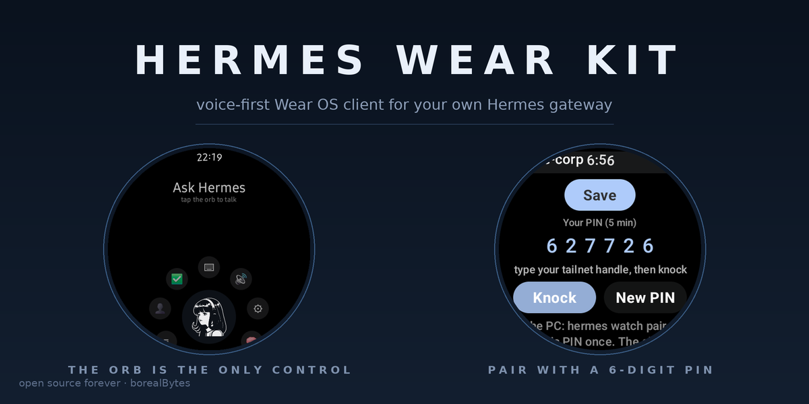
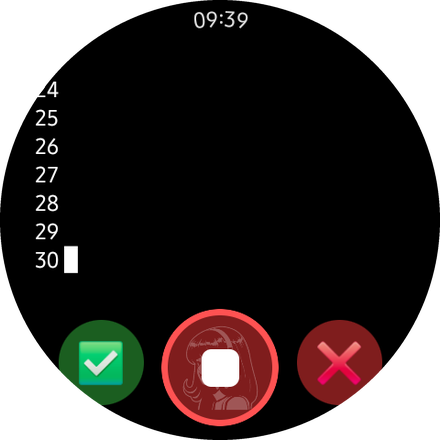
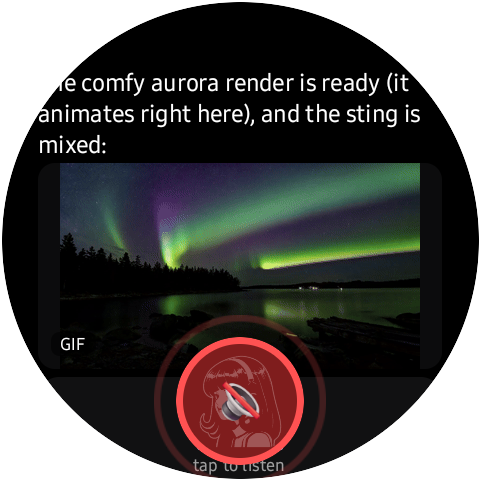
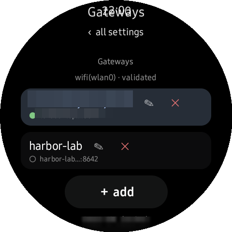

# Hermes Wear Kit — the watch half of your gateway

<p align="center">
  
</p>

<p align="center">
  <a href="https://github.com/borealBytes/hermes-wearos-plugin/releases/latest"></a>
  <a href="LICENSE"></a>
  <a href="https://hermes-agent.nousresearch.com"></a>
  <a href="https://github.com/borealBytes/hermes-wearos/actions/workflows/ci.yml"></a>
</p>

<p align="center"><b>▶ <a href="https://github.com/borealBytes/hermes-wearos/blob/main/docs/demo/voiceout-voicedemo/wearos-voice-demo.mp4">Watch the demo</a></b> — 46 s, one real pairing, one real question, answered out loud in the owner's cloned voice. <!-- TODO(x): swap to the native X post URL the day the announcement is live. --></p>

This is the Hermes plugin that pairs a Wear OS watch with your gateway and keeps it
answerable: [Hermes Wear OS](https://github.com/borealBytes/hermes-wearos) (the watch app, same
repo). The plugin runs on the gateway box inside Hermes; it owns pairing, the watch's tailnet
enrollment, the private lane the watch calls home on, and the Wear Kit pane in Hermes Desktop.
Stock watch bridges speak one vendor voice from a datacenter; this one clones *your* voice from
3 seconds of audio, computed on your gateway's CPU, and karaoke-lights the words on your wrist.
**Status, tiered:** hardware-proven on a Galaxy Watch Ultra (SM-L705U) and the Wear OS emulator;
the Play listing for the watch app is pending.

```bash
hermes plugins install borealBytes/hermes-wearos-plugin   # today; 'wearos' works once the catalog PR merges
```

**Testers welcome:** pair it against any Wear OS watch or the emulator — if the PIN flow takes
more than 30 seconds, I want to know.

<p align="center">
  
  
  
</p>

## Getting started (30 seconds, the shape the first-run test forced)

1. **Install** the plugin (above), open the **Wear Kit** tab in Hermes Desktop.
2. On the watch: install the app from [releases](https://github.com/borealBytes/hermes-wearos/releases/latest),
   open Settings ▸ Gateways ▸ Tailnet, paste your reusable tailnet authkey once.
3. **Type the host the pane shows you** — the bare `machine.tailnet` name under
   "wear kit host" (no `http://`, no port: the app completes those; the name resolves
   inside the tailnet without the `.ts.net` suffix).
4. **Knock** on the watch, **approve** the 6-digit code in the pane. Done — the watch answers.
5. Per-agent voice: tick an agent's box in the pane; the enable also syncs that agent's plugin
   bytes to the current release (checkbox = current code, not whatever an old install left behind).

## How pairing works (v2 — the shape a review forced)

The 6-digit **pairing code is minted by the gateway, never by the watch, and it never passes
through a model**. The window is **closed by default** and opened at the gateway (`hermes watch
pair`, the pane's Pair button, or a bare `/pair` typed on a local surface). One pairing per open
window; the window dies in 5 minutes.

1. **Knock.** The watch types your funnel handle into one field and taps Pair. `POST /pair/begin`
   carries a 256-bit device secret the watch just generated (64 hex, client-side), plus a label.
   Rate limits on the anonymous door slow floods but **never lock a legitimate pairing out**.
2. **Code.** The door answers with the 6-digit code; the watch shows it big. The code rides no URL
   from here on — only the secret does.
3. **Approve on your computer.** `hermes watch pair <CODE>` in a terminal, the Wear Kit pane's
   Approve button, `/pair <CODE>` on a local surface — those and only those. A messaging-platform
   reply (`/pair 123456` from Telegram, Discord, or the watch's own chat) is honestly told:
   *approve it on your computer*. Three wrong typed codes lock **approval** for 15 minutes; the
   watch's polls are never penalized. (RFC 8628 device-flow shape, with the pickup leg moved onto
   the device secret so the code can't be sprayed from a URL.)
4. **Pickup + ack.** The watch polls `GET /pair/poll?secret=…` (throttled per secret); after
   approval it collects the single-use Tailscale enrollment key (24 h default, tagged
   `tag:hermes-watch`, minted at approval, zeroed from the ledger the moment it's collected), then
   `POST /pair/ack` trades the secret for its permanent **device token** (`wtk-…`).
5. **The private lane carries the keys, not the public door.** The watch's embedded tsnet node
   enrolls, dials the gateway's **private lane** (`100.x:42654`, tailnet-facing, never Funnel),
   and opens a session. The lane resolves the caller's identity with `tailscale whois` on the
   peer IP — a watch *self-reporting* a node is never believed — and binds the node to the device
   on first sight: after binding, a different node with the same token is refused. That session —
   over the tunnel, under the just-verified whois — is the **only** thing that delivers
   `API_SERVER_KEY` and the watchkit bearer. The pairing packet itself carries neither.

**Grant law.** The device's own paired agent's key always flows over its lane, no grant, whatever
profile hosts the lane (one shared door + lane on a multiplexed gateway is the norm). Reaching
*another* agent's key requires a grant, per agent, on the Wear Kit pane (Gateways ▸ Agents);
until then the lane says so in as many words: `no key grant yet — approve it under Gateways ▸
Agents`.

**Revocation is full removal.** `hermes watch devices --revoke <name>` (or the pane) deletes the
tailnet node (admin API; id captured at bootstrap from whois, not from the watch), invalidates the
device token and clears its outbox queue, and rotates the agent's `API_SERVER_KEY` through Hermes.
For a **named profile** the rotation is hot — no restart. For the `default` profile the key is
cached at startup, so the plugin warns and asks; run the restart when it says so — for
`default` this means the **whole gateway restarts** (every profile on it blinks once). A watch
unpaired from the wrist (`Settings ▸ Gateways ▸ Forget`) posts `/watch/<agent>/forget` over its
own lane: same key rotation and, for the `default` profile, the same gateway restart — disclosed
here so nobody reads it as the watch "rebooting the server on its own".

## What you get installed

The Desktop app gains a **Wear Kit** page ([desktop/plugin.js](./desktop/plugin.js)): a
four-step checklist — *install the APK → pair the watch → enable agents → green lights* — where
the checkbox **is** the grant (checking enables the plugin for that profile and re-pins it to the
current bytes; unchecking revokes the agent from the watch's ring and never self-disables the
plugin; fresh installs grant nobody, and an Enable-all box sits over the list), a per-agent
**voice-out dropdown** riding the canonical `voiceout.yaml` store, the pairing window control
(the button opens it and toggles to a bare countdown chip; the live pending list carries
Approve), paired devices with live tailnet state and a Revoke button (no device row carries an
agent name — the row is the hardware, the grant is yours to make), per-agent **cron-alert
preference** (all runs / only failures / off), a one-click **Parakeet STT installer** (see
below), and ✅/❌ **readiness lights** where every red names its fix verb. Its data plane is
[dashboard/plugin_api.py](./dashboard/plugin_api.py), a FastAPI router
hot-mounted at `/api/plugins/wearos/*`: `/status`, `/pair/window|pending|claim`, `/devices`,
`/devices/revoke`, `/grants`, `/alerts`, `/enable`, `/stt`. The pane never calls tools — the
desktop SDK has no tool-call door (measured on v0.23.0), which is exactly why the REST half exists.

The agent gains **three** tools: `watch_send` (text/markdown to a watch — lands in its private
outbox and rings as a notification on the next lane poll), `watch_status` (paired devices, door and
lane state, readiness, and with `api: true` the tailscale-API checks), and `watch_pair` (no
arguments — opens the window for this agent and reports the pending codes; approval is a human's
act on a human surface, so the tool deliberately cannot approve). Enablement lives in the pane and
in the CLI (`hermes plugins enable wearos -p <profile>` — a fixed-argv subprocess of the *core*,
never a shell); there is no `watch_enable` tool. And a CLI: `hermes watch
pair|devices|setup|status`.

### Cron alerts (on by default, every agent with the plugin enabled)

Every finished or failed **cron run** of an agent that has this plugin enabled rings every watch
paired to that agent: `⏰ <job name> ✓ finished` / `✗ failed`. The job name comes from the cron
store (the run's `task_id` — race-free); the session row's `"<job name> · <date>"` title in the
profile's `state.db` (read **read-only**, never credentials) is the secondary; the copy degrades to
`cron run` rather than dropping the alert. Per-agent preference (all/failures/off) is on the pane.
The watch's Sessions screen has a ⏰ chip; the run itself opens like any other session (the rows
come from watchkit's `/sessions?source=cron`).

## The claim door and the private lane

[claim_server.py](./claim_server.py) is the ONE pre-enrollment network surface: loopback HTTP,
`127.0.0.1:42653`, Funnel-fronted at `/pair/*` alone. [private_api.py](./private_api.py) is the
post-enrollment lane: bound to the gateway's own tailnet IP on `:42654` — **never loopback, never
Funnel** — bearer = the device token.

```
POST /pair/begin  {"v":2,"secret":"<64 hex>","label":"<watch>","tailnet":"<handle>"}
                  → 201 {"code":"123456","expires_in":300} · window closed 403 · floods 429
GET  /pair/poll   ?secret=<hex>      (≥2 s between polls per secret)
                  → 204 pending · 200 {"state":"ready","authkey",…} once · 410 gone
POST /pair/ack    {"v":2,"secret":"<hex>"} → 200 {"token":"wtk-…","device":{…}} · 410
*  /pair/claim    → 426 Upgrade Required — the v1 protocol (code-in-URL) is retired

lane  POST /watch/<agent>/session   → binds node by WHOIS, returns the private bundle:
      {"api_key","profile","gateway_fqdn","gateway_port":8642,"watchkit_port":42651,"watchkit_token"}
lane  GET  /watch/<agent>/events?since=N / POST …/ack {up_to} / POST …/forget
```

The registry is **gateway-global**: one fcntl-locked `pairing.json` at the *gateway root's*
`plugin-data/wearos/` (a named profile's `…/profiles/<p>` home collapses to the root) — the door
is a single shared port hosted by the launch profile, so per-profile stores gave it a window it
could never see. Credentials: prefer a Tailscale **OAuth client** (`auth_keys` + `devices:core`,
restricted to the watch tag); an Owner/Admin API token also works — the wizard and README say
which is which.

Outbound hosts (nothing else): `api.tailscale.com` (key mint/tag/expiry + node DELETE),
`github.com` / `huggingface.co` / `pypi.org` (STT installer only), and `tailscale` CLI calls —
`status`/`whois` read-only, but **not** `funnel`: `hermes watch setup --fix serve` runs
`tailscale funnel --bg --https=443`, which MUTATES your tailnet's Funnel route (it is shown
in the wizard's consent card first). **No telemetry.** Third-party build chains (STT/TTS
installers) run with an allowlisted environment — the gateway's provider keys are never
inherited into a vendored `setup.py`.

## The STT installer (pane button, pinned + checksummed)

Voice-in on the watch can stream through **Parakeet** via transcribe.cpp on the gateway box. The
pane's Install button ([stt_install.py](./stt_install.py)) does the whole thing preview-first —
every step, host, byte estimate and the exact pins are shown before anything runs, and it's one
button:

- `github.com/handy-computer/transcribe.cpp` @ commit
  `5700f127e38dd53c4735ea23ef743b4b538eacd4` (fixed revision; git + cmake + g++ in a private venv),
- model `parakeet-unified-en-0.6b-Q8_0.gguf` (~731 MB) verified against SHA-256
  `4b50b6dd862bf6e346929aaf4f5eaacec003bfa3f56462d6c874b41ef2f38795` before use —
  **every official quant of that repo is selectable** (Q4_K_M 455 MB → F32 2.36 GB, one engine
  underneath): the pane's dropdown persists your choice, and the karaoke aligner follows it.
  Unpinned rows are size-gated and their observed SHA-256 is recorded at first fetch,
- **cache-first weights** (owner ruling): downloads land in a shared cache under
  `plugin-data/wearos/<installer>/cache/` keyed by repo+file — a completed file whose size/SHA
  matches the remote (HEAD etag) is hardlinked, never re-downloaded, and an interrupted
  download resumes with a Range request; STT and TTS installers share the discipline,
- everything under the plugin's own `plugin-data/wearos/stt/`; nothing system-wide, nothing sudo,
  cancellable, resumable, and the status line says `installed and verified` (or names what failed).

## The voice-out engine (TTS ▸ Voice-out card — consent, sources, no telemetry)

The Voice-out card adds **speech synthesis** to the kit: agents' replies spoken on the wrist
with zero-shot cloned voices, word-synced karaoke, all computed on your gateway's CPU. Nothing
is installed until you press **Review & install** on that card (rule 12), and the review
dialog lists every step, host, byte estimate and pin before anything runs.

- **What leaves your machine at install:** weight files DOWNLOADED from `huggingface.co`
  (model GGUF + audio codec, ~3.3 GB for the Q8 gateway slot) and the pinned runtime from
  `github.com` / `pypi.org` (`neuphonic/neutts` @ `ac69851f…`, private venv under
  `plugin-data/wearos/tts/`). No telemetry, no calls-home afterwards: synthesis text never
  leaves the box, and playback crosses only your own tailnet.
- **Source menu (the dropdown):** every published GGUF row we found is listed — official
  Neuphonic Q8/Q4 (gated: one consent click at the model page + a free HF token), and
  community re-quants (ungated, no account). Selections are **per device**: a `gateway` slot
  (its quant runs here) and a `watch` slot (Q4 by default; the files ride to the wrist in
  the on-device milestone). A re-quant is a re-encoded copy, not the vendor artifact: sizes
  differ from official by ~1 KB and the audio equivalence is proven by the sound test, not
  assumed — the menu says which rows are community mirrors.
- **The HF token** is this plugin's declared secret (`config_schema: hf_token`, env
  `HF_TOKEN`): read through the profile-scoped secret route; a paste into the card stores
  it 0600 in the plugin's own data dir; never echoed by any route, never logged, never
  needed for community rows.
- **Rule 17 note:** the official vendor rows are the checksum-pinned canonical fetch;
  community mirror rows are opt-in *within* the menu and every one states its repo and
  byte size in the review dialog before download.
- **The engine is a RESIDENT worker** (owner ruling 2026-11-10): one warm subprocess
  (private venv, never a shell, SIGKILL-safe) loads the GGUF once at gateway boot and
  keeps it loaded — speech answers instantly instead of paying a 30–90 s reload per
  call. Budget ~3.4 GB RSS while the gateway runs; a FIFO ticket gate serialises
  synthesis to ONE at a time, capped at 8 CPU threads at nice(10). Voice switching
  never reloads: the cloned card is a per-request zero-shot reference. Set
  `WEARKIT_TTS_IDLE_S=900` in the gateway env to restore sleep-between-calls on
  small boxes.

## Config options ([plugin.yaml](./plugin.yaml) → `config_schema`)

| Key | Type | Default | Notes |
|---|---|---|---|
| `tailnet` | str | — | Tailnet handle as shown in the admin console; validated live before anything is minted. May stay empty — the handle rides the watch's begin request. |
| `tailscale_api_token` | secret | — | Owner/Admin API token. **Either this or the OAuth pair below.** |
| `tailscale_oauth_client_id` | str | — | Preferred credential: scope to `auth_keys` + `devices:core`, restrict to the watch tag. |
| `tailscale_oauth_client_secret` | secret | — | Secret for the OAuth client (client_credentials flow). |
| `watch_tag` | str | `tag:hermes-watch` | ACL tag stamped on every enrolled watch node (ACL hygiene). |
| `key_expiry` | str | `24h` | Lifetime of the single-use enrollment key. |
| `watchkit_token` | secret | — | Optional helper-sidecar bearer handed to the watch **over its private lane** (nullable — leave unset with no sidecar). The lane reads it through the routed agent's secret scope: set it per profile (`.env` `watchkit_token=` or the Settings ▸ Plugins form). |
| `hf_token` | secret | — | Voice-out weights only, and only for GATED official rows (env `HF_TOKEN`, profile-scoped secret route; community rows need no account). Pane paste box stores 0600 in the plugin data dir; never echoed, never logged. |
| `claim_port` | int | `42653` | Loopback port of the funnel-facing claim door (127.0.0.1 only). |
| `private_port` | int | `42654` | Tailnet-IP port of the private lane (never loopback, never Funnel). |
| `apk_release_url` | str | `…releases/latest` | Where "install the watch app" points. |

Where state lives: install dir `~/.hermes/plugins/wearos/`; the pairing registry (window, pending
codes, devices, grants, outboxes, alert prefs) in the gateway-root `plugin-data/wearos/pairing.json`,
mode 0600, fcntl-locked for whole transactions (door, CLI and lane are different processes); the
door and lane are in-process daemon threads. Device tokens and PINs live only as SHA-256 hashes;
the enrollment key lives short-term and is zeroed at pickup.

## Wizard fix-verbs

`hermes watch setup` prints the readiness checklist; every red light names its fix.
`--fix credential` live-validates the OAuth pair / token and shows the discovered tailnet handle.
`--fix funnel` detects the `funnel` node attr in the ACL and, behind an explicit preview→approve,
PATCHes the one rule (JSON policies; huJSON tails get a console diff, never a blind write).
`--fix serve` reads `tailscale serve status` read-only and **prints** the command — the wizard
never executes system changes itself. (The admission scanner's one `sudo_usage` caution is that
printed suggestion — `sudo tailscale set --operator=…` — quoted for the human to run; the plugin
never shells out with sudo.)

## Requirements

- A **Tailscale account + tailnet** reachable from the Hermes host (`tailscaled` + MagicDNS).
  No Tailscale yet? `hermes watch setup` walks you through it, including an official-source
  installer fetch pinned by checksum.
- An **OAuth client** (recommended; `auth_keys` + `devices:core`, scoped to the watch tag) or an
  Owner/Admin **API token**, entered as plugin secrets — never a file the plugin opens.
- Funnel enabled on the gateway node, exposing only `/pair/*` (the wizard fixes the ACL).
- `requires_hermes >= 0.23.0` — the pane data plane (`ctx.rest` + hot-mounted `plugin_api.py`) is
  measured on v0.23.0.
- A **Wear OS 4+ watch** (Galaxy Watch 4 / Pixel Watch and later, min SDK 30), running APK
  **0.9.0 or newer** — v1's claim protocol is retired (the door answers `/pair/claim` with 426).
  The app installs today from the GitHub-Release APK; the **Play Store listing is in Google's
  approval queue**.
